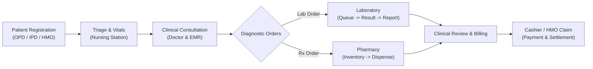
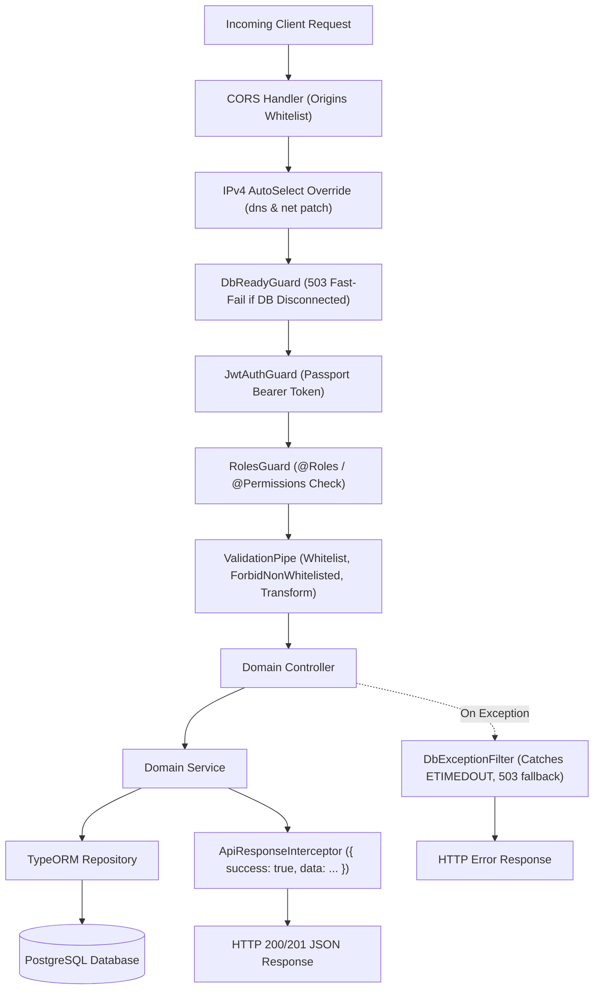
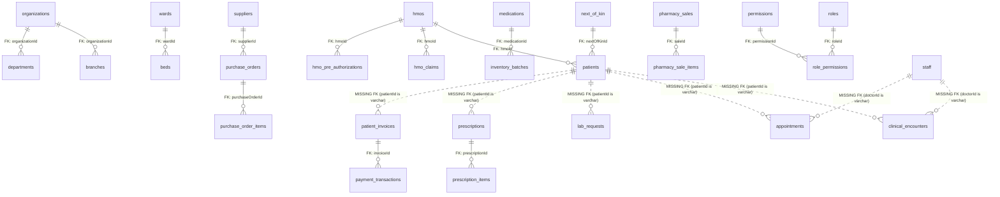
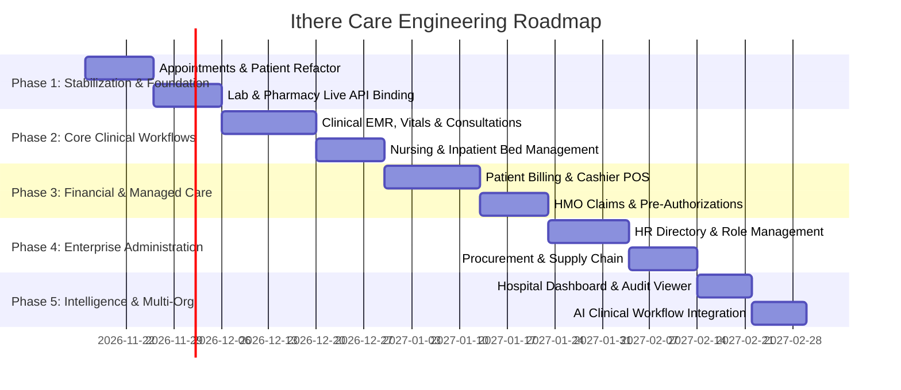

# ITHERE CARE — COMPREHENSIVE CODEBASE AUDIT & TECHNICAL ROADMAP
**Enterprise Hospital Information Management System (HMIS)**
*Platform Engineering Assessment & Implementation Blueprint*

---

**Document ID:** `ITHERE-CARE-AUDIT-2026-001`  
**Parent Entity:** Ithere Technology Group (`Ithere Systems – Hospital Edition`)  
**Target Codebases:**  
- **Frontend SPA:** `/home/kennytech/workdone/myclinical` (React 19 + TypeScript + Vite + AntD + Tailwind)  
- **Backend Service:** `/home/kennytech/workdone/myclinic-server` (NestJS 11 + TypeORM 0.3.28 + PostgreSQL)  
**Database:** PostgreSQL 16 (Neon Serverless AWS us-east-2, 35 schema tables)  
**Audit Date:** November 15, 2026  
**Auditor Mode:** Technical Audit & Strategic Engineering Planning (Non-Destructive)  

---

## 1. Executive Summary

### 1.1 Context and Purpose
**Ithere Care** is the flagship healthcare technology product developed under **Ithere Technology Group**. It is envisioned as a modern, modular, scalable, and commercially viable Hospital Information Management System (HMIS) with integrated Electronic Medical Records (EMR), clinical coordination, diagnostics, pharmacy, billing, and health insurance (HMO) administration.

This technical assessment establishes an authoritative baseline across both the frontend (`myclinical`) and backend (`myclinic-server`) codebases. Rather than treating the platform as a greenfield project or initiating an unnecessary rewrite, this audit rigorously catalogs what has already been built, assesses stability and data integrity, uncovers architectural and security gaps, and produces a battle-tested, phased development roadmap.

### 1.2 Summary of Key Findings

```
+----------------------------------------------------------------------------------------------------+
|                                      OVERALL MATURITY MATRIX                                       |
+----------------------------------------------------------------------------------------------------+
| Layer                 | Implemented Baseline                | Key Bottleneck / Disconnect          |
+-----------------------+-------------------------------------+--------------------------------------+
| Backend Architecture  | 15 NestJS Modules, 16 Controllers,  | Referential integrity: denormalized  |
|                       | 70+ Endpoints, 35 DB Tables         | IDs, unlinked patientId/doctorId     |
+-----------------------+-------------------------------------+--------------------------------------+
| Frontend Architecture | 169 Route Views, AntD 6, Tailwind,  | 144/169 pages (85.2%) are staging    |
|                       | Two-Rail Navigation Shell           | placeholders (HmisPlaceholderPage)   |
+-----------------------+-------------------------------------+--------------------------------------+
| End-to-End Integration| 3 Working Live Flows                | Major functional backends (Lab,      |
|                       | (Auth, Patient Reg, HMO Dropdown)   | Pharmacy, Appointments) use mocks    |
+-----------------------+-------------------------------------+--------------------------------------+
| Testing & QA          | Backend: 12 Suites (32 Unit Tests)  | Frontend: 0 Tests (No unit, e2e, or  |
|                       | Frontend: 0 Tests                   | integration tests exist)             |
+-----------------------+-------------------------------------+--------------------------------------+
```

1. **Working Modular Monolith Core:**  
   The backend (`myclinic-server`) possesses a well-structured, production-grade NestJS 11 modular monolith with cleanly isolated modules, DTO validation pipes, global error filters, and a centralized request pipeline. It has 70+ functioning REST endpoints covering Patient, Staff, Clinical, Lab, Pharmacy, HMO, Procurement, Billing, RBAC, and AI integration.

2. **The Frontend Staging Disconnect (The Core Finding):**  
   While the frontend (`myclinical`) presents an expansive 13-directorate navigation hierarchy with 169 mounted page views:
   - **Only 9 pages (5.3%)** are actively integrated with live backend APIs (Auth Login, Patient List, Patient Registration, and duplicate appointment views).
   - **16 pages (9.5%)** are interactive custom UI components backed entirely by static mock data files (`src/data/lab.mock.ts`, `src/data/pharmacy.ts`, `src/data/patients.ts`).
   - **144 pages (85.2%)** render structured UI placeholders (`HmisPlaceholderPage.tsx`) presenting domain metadata without backend state or interactive capabilities.
   - **Critical Mismatch:** The backend has fully functioning services and database persistence for Laboratory, Pharmacy, Appointments, and Finance, but the frontend ignores these endpoints and runs on static mock datasets.

3. **Database Referential Integrity & Multi-Tenant Typing Discrepancy:**  
   The PostgreSQL database features 35 active tables. However, foreign keys are missing across crucial transactional tables:
   - `clinical_encounters`, `vital_signs`, `admissions`, `appointments`, `lab_requests`, `prescriptions`, and `patient_invoices` store `patientId` as raw `character varying` without a foreign key referencing `patients.id` (which is integer-based).
   - `organizationId` suffers from type divergence: typed as `uuid` in `organizations` and `branches`, `integer` in `patients` and `staff`, and `varchar` in clinical/financial tables.

4. **Recommendation on Development Restart:**  
   Do **NOT** start building new modules or rewriting pages. The immediate priority is **Stabilization and Foundational Integration (Sprint 1)**: eliminate copy-pasted page duplication between Patients and Appointments, bind existing real backend endpoints (`/appointments`, `/lab/*`, `/pharmacy/*`) to the existing UI, enforce database foreign key constraints, and establish frontend testing.

---

## 2. Product Overview & Vision

### 2.1 The Ithere Care Vision
Ithere Care is developed as the foundational healthcare core of the **Ithere Technology Group** product suite (`Ithere Care`, `Ithere Talent`, `Ithere Enterprise`, `Ithere Learn`, and `Ithere Systems`).

The commercial vision requires a multi-organization, multi-branch Hospital Information Management System (HMIS) that complies with healthcare data standards (HL7/FHIR readiness, ICD-10 clinical coding, strict audit compliance) and manages the entire patient journey:



### 2.2 Operational Scope Breakdown

| Domain Area | Target Product Capability | Current Codebase Status |
| :--- | :--- | :--- |
| **Identity & Access** | Multi-role authentication, RBAC, organization context | **Backend Ready / Frontend UI Placeholder** |
| **Patient Administration** | Registration, demographics, Next of Kin, medical record number | **Functional & Live Integrated** |
| **Appointments** | Doctor scheduling, slot booking, clinic calendar, queue | **Backend Ready / Frontend Mock Duplication** |
| **Clinical Services (EMR)** | Encounters, ICD-10, SOAP notes, vital signs, ward admissions | **Backend Ready / Frontend UI Placeholder** |
| **Laboratory Services** | Test requests, sample tracking, bench queue, result entry, verification, PDF reports | **Backend Ready / Frontend Mock UI** |
| **Pharmacy & Dispensing** | Drug formulary, inventory batches, e-prescriptions, dispensing, POS sales | **Backend Ready / Frontend Mock UI** |
| **Billing & Finance** | Patient invoices, cashier point-of-sale, payment reconciliation, general ledger | **Backend Partial / Frontend UI Placeholder** |
| **HMO & Managed Care** | Enrollee verification, pre-authorization, tariffs, claims submission & reconciliation | **Backend Partial / Frontend UI Placeholder** |
| **Human Resources** | Staff directory, credentialing, duty rostering, payroll, leave management | **Backend Partial / Frontend UI Placeholder** |
| **Procurement & Inventory** | Vendor management, purchase requisitions, PO approval, goods received notes | **Backend Partial / Frontend UI Placeholder** |
| **Audit & Governance** | Immutable audit logs, clinical audits, incident reporting, compliance | **Backend Ready / Frontend UI Placeholder** |
| **AI Integration** | Clinical document summarization, assistant panel, ICD-10 coding suggestion | **Backend Ready / Frontend Component Staged** |

---

## 3. Technology Stack Assessment

### 3.1 Frontend Stack (`myclinical`)
- **Core Runtime:** React `^19.2.0` with `react-dom` `^19.2.0`
- **Language:** TypeScript `~5.9.3` (Strict mode configured in `tsconfig.app.json`)
- **Build Engine:** Vite `^7.3.1` using `@vitejs/plugin-react-swc` `^4.2.2` (SWC compilation)
- **UI Framework:** Ant Design (`antd`) `^6.3.1`
- **Styling Architecture:** Tailwind CSS `3` with PostCSS `^8.5.6` and `autoprefixer` `^10.4.24`
- **Navigation & Routing:** `react-router-dom` `^7.13.1`
- **Server State Management:** `@tanstack/react-query` `^5.90.21`
- **Client State Management:** `zustand` `^5.0.11` (with `persist` middleware)
- **HTTP Client:** `axios` `^1.13.5` with centralized JWT request/response interceptors
- **Visualizations:** `recharts` `^3.7.0`
- **Icons & Dates:** `lucide-react` `^0.575.0`, `dayjs` `^1.11.19` (with `isBetween` plugin)
- **Toast Notifications:** `react-hot-toast` `^2.6.0`

### 3.2 Backend Stack (`myclinic-server`)
- **Core Framework:** NestJS `^11.0.1` (`@nestjs/core`, `@nestjs/common`, `@nestjs/platform-express`)
- **Architecture:** Modular Monolith with Domain-Driven Module Isolation
- **Language:** TypeScript `^5.7.3` on Node.js `v22.22.1`
- **Database & ORM:** PostgreSQL 16 (Neon Serverless AWS us-east-2) with TypeORM `^0.3.28` and `@nestjs/typeorm` `^11.0.1`
- **Database Driver:** `pg` `^8.20.0`
- **Security & Authentication:** `@nestjs/jwt` `^11.0.2`, `@nestjs/passport` `^11.0.5`, `passport-jwt` `^4.0.1`, `bcrypt` `^6.0.0`
- **Validation & Transformation:** `class-validator` `^0.15.1`, `class-transformer` `^0.5.1`
- **Configuration Management:** `@nestjs/config` `^4.0.4`
- **Testing Engine:** Jest `^29.7.0` with `ts-jest` `^29.2.5`

---

## 4. Frontend Architecture Audit (`myclinical`)

### 4.1 Folder Structure & Organization
```
myclinical/src/
├── app/               # React Query client instance (queryClient.ts), appInfo.ts
├── assets/            # Static icons, vector assets
├── components/        # Reusable and module-specific UI components
│   ├── ai/            # AiAssistantPanel, AiStatusBanner, AiSummaryCard, AiFeedbackControls
│   ├── Lab/           # QueueItem, TableRow, StatCard, Lab filters
│   ├── modal/         # PatientProfile, OpdPatientProfile, LabResultModal, LabReportModal
│   ├── navigation/    # MainSidebar.tsx (Level 1), DepartmentSubSidebar.tsx (Level 2)
│   ├── Patients/      # PatientsFilter.tsx
│   ├── pharmacy/      # PurchaseOrderFilters, SalesFilter, SalesAnalytics, InventoryFilters
│   ├── skeletons/     # DashboardCardSkeleton.tsx, TableSkeleton.tsx
│   ├── ui/            # HmisPlaceholderPage.tsx, SectionHeader.tsx, StatsCard.tsx, CustomDatePicker
│   ├── Header.tsx     # Application top bar with breadcrumbs, theme toggle, profile menu
│   └── Sidebar.tsx    # Legacy single-sidebar component (superseded by MainSidebar)
├── data/              # Static mock datasets (patients.ts, appointments.ts, lab.mock.ts, pharmacy.ts)
├── features/          # Feature API hooks (auth/authApi.ts, hmo/useHmos.ts)
├── layouts/           # DashboardLayouts.tsx (Primary layout shell mounting both sidebars + Header)
├── navigation/        # navigationConfig.ts (13 departments, 150+ sub-routes, path resolver)
├── pages/             # 169 route page components across 17 directories
├── routes/            # AppRoutes.tsx (central routing), ProtectedRoutes.tsx (auth/role guard)
├── services/          # api.ts (Axios), auth.service.ts, patient.service.ts, hmo.service.ts, ai.service.ts
├── store/             # auth.store.ts, patient.store.ts (Zustand)
├── theme/             # themeConfig.ts (Ant Design theme tokens)
├── types/             # TypeScript type definitions and DTO contracts
└── utils/             # dayJs.ts, useTabActions.ts, QuickActionCard.tsx
```

### 4.2 Application Shell & Navigation
The application features a modern **Two-Rail Navigation Architecture**:
1. **Primary Department Rail (`MainSidebar.tsx`):** Renders the 13 clinical and administrative departments (`HMIS_DEPARTMENTS`) with icon badges and quick keyboard department search (`Cmd/Ctrl + D`).
2. **Contextual Sub-Sidebar (`DepartmentSubSidebar.tsx`):** Automatically computes the active department based on the URL pathname using `findDepartmentByPath()` and renders grouped sub-modules with real-time route filtering.
3. **Workspace Canvas (`DashboardLayouts.tsx`):** Standardizes breadcrumbs, notifications, tenant indicators, and responsive mobile drawers.

### 4.3 Detailed Page Implementation Categorization (169 Total Pages)

#### Tier 1: Live API-Integrated Pages (9 Pages / 5.3%)
- [src/pages/auth/Login.tsx](file:///home/kennytech/workdone/myclinical/src/pages/auth/Login.tsx) — Communicates with `POST /auth/login`. Sets JWT in Zustand `useAuthStore` and redirects to `/dashboard`.
- [src/pages/patients/Patients.tsx](file:///home/kennytech/workdone/myclinical/src/pages/patients/Patients.tsx) — Communicates with `GET /patients` via `usePatientStore`. Displays live patient directory with pagination, search, and filtering.
- [src/pages/patients/CreatePatientDashboard.tsx](file:///home/kennytech/workdone/myclinical/src/pages/patients/CreatePatientDashboard.tsx) — Renders patient registration selection (OPD vs. IPD).
- [src/pages/patients/CreateNewPatient.tsx](file:///home/kennytech/workdone/myclinical/src/pages/patients/CreateNewPatient.tsx) — 5-step registration wizard (Personal info, Next of Kin, Medical history, HMO, Verification). Submits payload to `POST /patients` and fetches HMO list via `GET /hmos`.
- [src/pages/patients/CreateOPDPatient.tsx](file:///home/kennytech/workdone/myclinical/src/pages/patients/CreateOPDPatient.tsx) — Simplified outpatient registration submitting to `POST /patients`.
- **4 Duplicated Pages in `src/pages/appointments/`:** `Home.tsx`, `CreateNewPatient.tsx`, `CreateOPDPatient.tsx`, `CreatePatientDashboard.tsx` (These are identical copies of patient registration views rather than appointment views).

#### Tier 2: Interactive Mock-Data Pages (16 Pages / 9.5%)
- [src/pages/dashboard/HospitalDashboard.tsx](file:///home/kennytech/workdone/myclinical/src/pages/dashboard/HospitalDashboard.tsx) — Interactive KPI metrics, patient volume charts, department breakdown. Uses static hardcoded mock constants.
- [src/pages/patients/PatientDashboard.tsx](file:///home/kennytech/workdone/myclinical/src/pages/patients/PatientDashboard.tsx) — Patient analytics charts backed by `src/data/patients.ts`.
- **Pharmacy Suite (7 Pages in `src/pages/pharmacy/`):**
  - `PharmacyDashboard.tsx`, `Medications.tsx`, `Inventory.tsx`, `Prescriptions.tsx`, `Suppliers.tsx`, `PharmacyOrders.tsx`, `Sales.tsx`.
  - All feature full UI components (tables, search, status badges, forms) but read from and mutate local state initialized from `src/data/pharmacy.ts`.
- **Laboratory Suite (6 Pages in `src/pages/lab/`):**
  - `LabDashboard.tsx`, `NewLabRequests.tsx`, `LabRequests.tsx`, `LabQueue.tsx`, `LabResults.tsx`, `LabReports.tsx`.
  - Complete multi-step bench workflows (sample intake, test execution, report sign-off) backed by `src/data/lab.mock.ts`.
  - *Bug Discovered:* Navigation buttons in `LabDashboard.tsx` and `NewLabRequests.tsx` point to `/pharmacy-diagnostics/lab-requests` instead of `/lab/requests`, triggering an unmapped route redirect to `/login`.

#### Tier 3: Staged Domain Placeholder Pages (144 Pages / 85.2%)
Render `HmisPlaceholderPage.tsx` with customized department headers, operational metrics, workflow tabs, and capability checklists:
- `src/pages/clinical/*` (14 pages: Doctor Management, Nursing, OPD, IPD, ICU, Emergency, Wards, Vitals, Theatre, Maternity, Discharge)
- `src/pages/finance/*` (11 pages: Billing, Cashier POS, General Ledger, Accounts Payable/Receivable, Budgets)
- `src/pages/hmo/*` (11 pages: HMO Companies, Enrollees, Authorizations, Claims, Tariffs)
- `src/pages/hr/*` (14 pages: Staff Directory, Attendance, Leave, Rostering, Payroll, Recruitment)
- `src/pages/procurement/*` (15 pages: Purchase Orders, Vendor Management, Store, Stock Reconciliation)
- `src/pages/operations/*` (14 pages: Facilities, Biomedical Engineering, Waste, Security, Maintenance)
- `src/pages/quality/*` (13 pages: Clinical Audit, Infection Control, Patient Safety, SOPs)
- `src/pages/ict/*` (12 pages: System Config, Access Management, Cybersecurity, Disaster Recovery)
- `src/pages/analytics/*` (10 pages: Clinical Analytics, Financial Analytics, Performance, KPIs)
- `src/pages/system-admin/*` (5 pages: Hospital Config, Department Config, Roles, Permissions)

### 4.4 Frontend Architecture Issues & Code Smells
1. **Architectural State Schism:**  
   The project has two competing data-fetching architectures: `features/` uses `@tanstack/react-query` (`useHmos.ts`, `authApi.ts`), while `services/` + `store/` uses manual Zustand arrays (`patient.store.ts` manually maintaining `loading`, `error`, `patients[]`).
2. **Eager Monolithic Route Bundle:**  
   [src/routes/AppRoutes.tsx](file:///home/kennytech/workdone/myclinical/src/routes/AppRoutes.tsx) contains 169 static `import` declarations at the top of the file. No `React.lazy()` or `<Suspense>` route splitting is implemented.
3. **Severe Code Duplication in Appointments:**  
   The entire `src/pages/appointments/` directory contains copy-pasted files from `src/pages/patients/`. In fact, `src/pages/appointments/Home.tsx` loads `usePatientStore().patients` and reads `localStorage.getItem("patient-tab")`.
4. **Complete Absence of Automated Tests:**  
   `myclinical/src` contains **0 test files** (`.spec.ts` or `.test.tsx`). No test runner (Vitest or Jest) is configured in `package.json`.

---

## 5. Backend Architecture Audit (`myclinic-server`)

### 5.1 Architecture & Pipeline Design
The backend is structured as an enterprise **Modular Monolith** using NestJS 11:



### 5.2 Module Catalog & API Capability (15 Modules, 16 Controllers)

| Module | Primary Controller Prefix | Endpoints Implemented | Key Domain Capabilities |
| :--- | :--- | :--- | :--- |
| **AuthModule** | `/auth` | 5 | Login, token issuance, user profile (`/auth/me`), change password. |
| **PatientModule** | `/patients` | 7 | Complete CRUD, aggregate statistics, Next of Kin association, soft delete. |
| **AppointmentModule**| `/appointments` | 6 | Scheduling, status tracking (Scheduled, Completed, Cancelled), stats. |
| **ClinicalModule** | `/clinical` | 13 | Encounters, SOAP notes, vital signs recording, ward bed admissions. |
| **LabModule** | `/lab` | 14 | Lab requests, specimen queue, result entry, verification, PDF reports. |
| **PharmacyModule** | `/pharmacy` | 17 | Drug formulary, inventory batches, prescription dispensing, POS sales. |
| **BillingModule** | `/finance` | 5 | Patient invoicing, point-of-sale payments, revenue summaries. |
| **HmoModule** | `/hmos` | 11 | HMO provider management, pre-authorization codes, claims processing. |
| **HrModule** | `/hr/staff` | 7 | Comprehensive staff directory, employee credentialing, profile updates. |
| **ProcurementModule**| `/procurement`| 8 | Suppliers, purchase orders, inventory receiving. |
| **OrganizationModule**| `/organizations`, `/branches`, `/departments`, `/settings` | 12 | Multi-tenancy shell, branch management, departmental hierarchy. |
| **RbacModule** | `/roles`, `/permissions` | 6 | Role definition, granular permission assignment matrix. |
| **AuditModule** | `/audit-logs` | 2 | Immutable security logging (actor, IP, module, entity, payload). |
| **DashboardModule** | `/dashboard`, `/analytics` | 2 | Hospital operational KPIs, bed occupancy, departmental summaries. |
| **AiModule** | `/ai`, `/api/ai` | 8 | Governed LLM integration, clinical notes summarization, audit trails. |

### 5.3 Backend Test Suite Verification
The backend includes a functional Jest test harness with **12 passed test suites (32 unit tests)** verified during audit execution:
- `api-response.interceptor.spec.ts` (PASS)
- `patient.service.spec.ts` & `patient.controller.spec.ts` (PASS)
- `pharmacy.service.spec.ts` (PASS)
- `lab.service.spec.ts` (PASS)
- `ai.service.spec.ts` & `ai.controller.spec.ts` (PASS)
- `auth.service.spec.ts` & `auth.controller.spec.ts` (PASS)
- `hmo.service.spec.ts` & `hmo.controller.spec.ts` (PASS)
- `billing.service.spec.ts` (PASS)

---

## 6. Frontend-Backend Integration Audit

### 6.1 Integration Topology & Protocol
- **Communication Protocol:** RESTful JSON over HTTP/1.1 (Axios).
- **Base URL:** `import.meta.env.VITE_API_URL || "http://localhost:3000"`.
- **Envelope Standardization:**
  - Backend responds with standardized `{ success: true, data: T, message: string }` via `ApiResponseInterceptor`.
  - Frontend services (`patient.service.ts`, `hmo.service.ts`, `ai.service.ts`) implement `unwrapEnvelope()` to extract `payload.data`.
- **Authentication Lifecycle:**
  - JWT stored in localStorage via Zustand `persist` (`auth-storage`).
  - Axios request interceptor dynamically injects `Authorization: Bearer <token>` on all non-public routes.
  - Axios response interceptor catches `401 Unauthorized`, clears local state via `useAuthStore.getState().logout()`, and redirects to `/login`.

### 6.2 Endpoint Integration Gap Analysis

```
+---------------------------------------------------------------------------------------------------------+
|                                    LIVE INTEGRATION GAP MATRIX                                          |
+---------------------+-------------------------------+-------------------------+-------------------------+
| Functional Domain   | Backend Endpoint Status       | Frontend Consumer       | Actual Integration State|
+---------------------+-------------------------------+-------------------------+-------------------------+
| Authentication      | POST /auth/login              | auth.service.ts / Login | FULLY INTEGRATED        |
| Current User        | GET /auth/me                  | None                    | UNUSED BY FRONTEND      |
| Patient Directory   | GET /patients                 | patient.service.ts      | FULLY INTEGRATED        |
| Patient Registration| POST /patients                | patient.service.ts      | FULLY INTEGRATED        |
| Patient Stats       | GET /patients/stats           | None                    | UNUSED (Frontend mocks) |
| Patient Updates     | PATCH /patients/:id           | None                    | UNUSED (Modal is local) |
| HMO List            | GET /hmos                     | hmo.service.ts          | INTEGRATED (Dropdown)   |
| HMO Claims & Auth   | /hmos/claims, /authorizations | None (Placeholder)      | UNUSED BY FRONTEND      |
| Appointments        | /appointments/* (CRUD)        | None (Mocks Patients)   | DISCONNECTED COMPLETELY |
| Clinical Encounters | /clinical/encounters          | None (Placeholder)      | UNUSED BY FRONTEND      |
| Vital Signs         | /clinical/vitals              | None (Placeholder)      | UNUSED BY FRONTEND      |
| Lab Requests        | /lab/requests                 | None (Mock data file)   | DISCONNECTED COMPLETELY |
| Lab Results         | /lab/results                  | None (Mock data file)   | DISCONNECTED COMPLETELY |
| Lab Reports         | /lab/reports                  | None (Mock data file)   | DISCONNECTED COMPLETELY |
| Medications         | /pharmacy/medications         | None (Mock data file)   | DISCONNECTED COMPLETELY |
| Prescriptions       | /pharmacy/prescriptions       | None (Mock data file)   | DISCONNECTED COMPLETELY |
| Pharmacy Sales      | /pharmacy/sales               | None (Mock data file)   | DISCONNECTED COMPLETELY |
| Invoices & Billing  | /finance/invoices             | None (Placeholder)      | UNUSED BY FRONTEND      |
| Staff Management    | /hr/staff/*                   | None (Placeholder)      | UNUSED BY FRONTEND      |
| Hospital KPIs       | /dashboard/summary            | None (Hardcoded stats)  | DISCONNECTED COMPLETELY |
| AI Chat & Summary   | /ai/chat, /ai/summarise       | ai.service.ts           | SERVICE ONLY (No view)  |
+---------------------+-------------------------------+-------------------------+-------------------------+
```

---

## 7. Database & Data Model Assessment

### 7.1 Schema Inventory (35 PostgreSQL Tables)
The active database schema contains 35 tables managed via TypeORM migrations and auto-synchronization in development:

```
Core Platform (6):      organizations, branches, departments, roles, permissions, role_permissions
Audit & Settings (2):   audit_logs, system_settings
Patients (3):           patients, next_of_kin, migrations
Appointments (1):       appointments
Clinical Care (4):      clinical_encounters, vital_signs, wards, beds, admissions
Diagnostics (3):        lab_requests, lab_results, lab_reports
Pharmacy (6):           medications, inventory_batches, prescriptions, prescription_items,
                        pharmacy_sales, pharmacy_sale_items
Procurement (3):        suppliers, purchase_orders, purchase_order_items
Financial (2):          patient_invoices, payment_transactions
Managed Care (3):       hmos, hmo_pre_authorizations, hmo_claims
Workforce (1):          staff
```

### 7.2 Database Design Weaknesses & Integrity Risks



1. **Missing Foreign Keys & Primary Key Incompatibility:**  
   `patients.id` is defined as an auto-incrementing `integer` (serial). However, `appointments.patientId`, `clinical_encounters.patientId`, `lab_requests.patientId`, `prescriptions.patientId`, and `patient_invoices.patientId` are defined as `character varying` (varchar). Because of this type mismatch, **no database foreign key constraints exist between patients and any clinical, diagnostic, or financial records**.
2. **Denormalized String Fields:**  
   `patientName`, `doctorName`, `wardName`, and `supplierName` are stored as raw text strings across clinical and order tables. If a patient updates their legal name, past records will become out of sync.
3. **Multi-Tenant `organizationId` Type Mismatch:**  
   `organizations.id` is a `uuid`. However:
   - `patients.organizationId` and `staff.organizationId` are typed as `integer`.
   - `clinical_encounters.organizationId`, `lab_requests.organizationId`, `prescriptions.organizationId`, and `roles.organizationId` are typed as `character varying`.
   This makes cross-table tenant enforcement fragile and prevents foreign key cascading.
4. **Mixed ID Strategies:**  
   The schema mixes `integer` serial keys (`patients`, `staff`, `hmos`, `next_of_kin`) with `uuid` keys (`organizations`, `medications`, `prescriptions`, `invoices`, `encounters`).

---

## 8. Complete Module Completeness Register

| # | Functional Module | Frontend Status | Backend Status | Integration Status | Overall Status | Immediate Action Required |
|---|---|---|---|---|---|---|
| 1 | **Authentication & Identity** | UI Active (`Login.tsx`) | Complete (`/auth`) | Integrated | **PARTIALLY COMPLETE** | Implement token refresh; connect `/auth/me` to header profile. |
| 2 | **Role-Based Access Control** | Placeholders (`system-admin`) | Complete (`/roles`, `/permissions`) | Disconnected | **BACKEND ONLY** | Enforce `allowedRoles` on frontend `ProtectedRoutes`; build role editor. |
| 3 | **Patient Management** | UI Active (`Patients.tsx`, Wizards) | Complete (`/patients`) | Integrated | **COMPLETE (Baseline)** | Connect `PATCH /patients/:id` to patient edit modal; wire `stats`. |
| 4 | **Appointments & Scheduling** | Mock / Duplicate Patient UI | Complete (`/appointments`) | Disconnected | **BACKEND ONLY** | Replace duplicate patient files with real calendar & booking UI. |
| 5 | **Clinical EMR & Documentation** | 14 Placeholders (`clinical/*`) | Complete (`/clinical`) | Disconnected | **BACKEND ONLY** | Connect vitals, consultations, and ward admissions to backend. |
| 6 | **Laboratory Services** | Interactive Mock (`lab.mock.ts`) | Complete (`/lab`) | Disconnected | **NEEDS INTEGRATION** | Replace `lab.mock.ts` imports with React Query hooks calling `/lab/*`. |
| 7 | **Pharmacy & Dispensing** | Interactive Mock (`pharmacy.ts`) | Complete (`/pharmacy`) | Disconnected | **NEEDS INTEGRATION** | Replace `pharmacy.ts` imports with React Query hooks calling `/pharmacy/*`. |
| 8 | **Billing & Invoicing** | 11 Placeholders (`finance/*`) | Complete (`/finance`) | Disconnected | **BACKEND ONLY** | Build invoice creation & cashier payment UI calling `/finance/*`. |
| 9 | **HMO & Insurance** | 11 Placeholders (Dropdown only) | Complete (`/hmos`) | Partial | **BACKEND ONLY** | Build claims tracking and pre-authorization authorization views. |
| 10| **HR & Workforce Management** | 14 Placeholders (`hr/*`) | Complete (`/hr/staff`)| Disconnected | **BACKEND ONLY** | Build Staff Directory and credentialing tables calling `/hr/staff`. |
| 11| **Procurement & Inventory** | 15 Placeholders (`procurement/*`)| Complete (`/procurement`)| Disconnected | **BACKEND ONLY** | Build Purchase Order creation and Supplier management tables. |
| 12| **Multi-Tenancy & Org Admin** | 5 Placeholders (`system-admin`)| Complete (`/organizations`)| Disconnected | **BACKEND ONLY** | Build branch switcher and hospital configuration forms. |
| 13| **Audit & Quality Assurance** | Placeholders (`ict`, `quality`) | Complete (`/audit-logs`)| Disconnected | **BACKEND ONLY** | Build immutable audit log viewer calling `GET /audit-logs`. |
| 14| **Hospital Dashboard & KPIs** | Mock Hardcoded Cards | Complete (`/dashboard`)| Disconnected | **NEEDS INTEGRATION** | Wire `HospitalDashboard.tsx` to `GET /dashboard/summary`. |
| 15| **AI Integration & Governance** | Service & Components Ready | Complete (`/ai`) | Partial | **PARTIALLY COMPLETE** | Embed `AiAssistantPanel` into patient EMR and consultation views. |

---

## 9. Security & Healthcare Data Protection Assessment

### 9.1 Authentication & Session Management
- **Password Security:** Passwords hashed with `bcrypt` (10 rounds). Passwords never returned in queries (`select: false` on `Staff.password`).
- **Token Security:** Signed with HMAC-SHA256. Expiry is currently fixed at 24 hours (`1d`).
- **Risk:** No refresh token rotation or revocation blacklist. If a token is compromised, it remains valid until expiration.
- **Frontend Vulnerability:** Token stored in `localStorage` (`auth-storage`). While common for SPAs, this exposes tokens to Cross-Site Scripting (XSS). Future hardening should move to secure `httpOnly` cookies.

### 9.2 Authorization & RBAC Enforcement
- **Backend:** Robust `@UseGuards(JwtAuthGuard, RolesGuard)` with `@Roles()` decorator.
- **Frontend Vulnerability:** In `AppRoutes.tsx`, routes are wrapped with `<ProtectedRoute>` but **omit `allowedRoles`**. A logged-in user with any role can directly access administrative, financial, and clinical routes by typing the URL.

### 9.3 Protected Health Information (PHI) & Multi-Tenancy Isolation
- **PHI Leakage Risk:** Patient allergies and chronic conditions are stored in plain text.
- **Tenant Leakage Risk:** While entities possess an `organizationId` column, several controllers (`clinical.controller.ts`, `lab.controller.ts`) lack automatic tenant scoping middleware. If a doctor passes a query without an organization filter, records from other organizations could be returned.

---

## 10. Prioritized Development Roadmap



### Phase 1 — Foundation, Deduplication & Primary Integration (Sprint 1–2)
- **Objective:** Eliminate frontend duplication, stabilize core dependencies, and connect existing mock pages to live backend APIs.
- **Deliverables:**
  1. Refactor `src/pages/appointments/`: Replace duplicated patient code with a genuine Appointment Calendar and Booking workflow calling `GET/POST /appointments`.
  2. Bind Laboratory pages (`LabDashboard`, `LabRequests`, `LabQueue`, `LabResults`) to `GET/POST /lab/*`.
  3. Bind Pharmacy pages (`Medications`, `Inventory`, `Prescriptions`, `Sales`) to `GET/POST /pharmacy/*`.
  4. Fix navigation links in `LabDashboard.tsx` (`/pharmacy-diagnostics` -> `/lab/requests`).
  5. Setup Vitest in `myclinical` and write initial component tests.

### Phase 2 — Core Clinical Workflows & EMR (Sprint 3–4)
- **Objective:** Transform Clinical placeholder pages into operational clinical consoles.
- **Deliverables:**
  1. Patient EMR View: Consultations, clinical encounters, SOAP notes, ICD-10 diagnosis.
  2. Nursing Triage Station: Vital signs logging (`POST /clinical/vitals`) with abnormal threshold alerts.
  3. Inpatient & Admission Management: Bed allocation, ward transfers, and discharge summaries.
  4. One-click clinical ordering: Direct ordering of lab tests and e-prescriptions from the doctor's consultation screen.

### Phase 3 — Financial Operations & HMO Managed Care (Sprint 5–6)
- **Objective:** Enable end-to-end revenue cycle management and insurance processing.
- **Deliverables:**
  1. Cashier Point-of-Sale (POS) and Patient Invoicing calling `/finance/invoices` and `/finance/payments`.
  2. HMO Management Console: Pre-authorization code generator and claims reconciliation calling `/hmos/*`.
  3. Automated billing generation triggered by lab test completion or pharmacy medication dispensing.

### Phase 4 — Enterprise Administration & Supply Chain (Sprint 7–8)
- **Objective:** Operationalize HR, staff credentialing, and procurement.
- **Deliverables:**
  1. Staff Directory, credential tracking, and employee profile management calling `/hr/staff/*`.
  2. RBAC Management: Interactive role creation and permission matrix calling `/roles` and `/permissions`.
  3. Procurement Requisitions and Goods Received Notes (GRN) calling `/procurement/*`.

### Phase 5 — Management Intelligence, AI & Multi-Organization (Sprint 9–10)
- **Objective:** Deliver executive visibility, audit compliance, and governed AI assistance.
- **Deliverables:**
  1. Connect `HospitalDashboard.tsx` to live backend data from `GET /dashboard/summary`.
  2. Build Audit Log Viewer calling `GET /audit-logs`.
  3. Embed `AiAssistantPanel` into clinical consultation views for discharge summary generation and ICD-10 suggestions.
  4. Organization & Branch Switcher in Header for multi-hospital deployments.

---

## 11. Recommended Starting Point: Sprint 1 Plan

### 11.1 The Exact Starting Point
**Domain:** Patient & Appointment Workflow Deduplication and Stabilization  
**Rationale:** The hospital journey begins at Patient Registration and Appointment Scheduling. Right now, `src/pages/appointments/` contains 4 exact copies of `src/pages/patients/`, and the appointments view displays patients instead of appointments. Meanwhile, the backend `/appointments` service is 100% complete with full CRUD and database storage. Stabilizing this foundation unlocks the entire clinical pipeline.

### 11.2 Sprint 1 Work Breakdown (10 Working Days)

```
+----------------------------------------------------------------------------------------------------+
|                                    SPRINT 1 TASK BREAKDOWN                                         |
+-------+----------------------------------+------------------------------------+--------------------+
| Day   | Focus Area                       | Files Impacted                     | Measurable Output  |
+-------+----------------------------------+------------------------------------+--------------------+
| 1–2   | Appointments Deduplication       | myclinical/src/pages/appointments/ | Delete duplicates; |
|       |                                  | (Home.tsx, CreateNewPatient.tsx)   | create clean views |
+-------+----------------------------------+------------------------------------+--------------------+
| 3–4   | Appointment Service & API Hook   | myclinical/src/services/           | React Query hooks  |
|       |                                  | appointment.service.ts (NEW)       | calling /appoint-  |
|       |                                  | myclinical/src/features/appoint... | ments endpoints    |
+-------+----------------------------------+------------------------------------+--------------------+
| 5–6   | Appointment Booking Modal & List | myclinical/src/components/modal/   | Book appointments; |
|       |                                  | appointments/BookAppointmentModal  | view clinic roster |
+-------+----------------------------------+------------------------------------+--------------------+
| 7–8   | Laboratory Mock -> API Migration | myclinical/src/services/lab.service| Replace lab.mock.ts|
|       |                                  | myclinical/src/pages/lab/*         | with live API calls|
+-------+----------------------------------+------------------------------------+--------------------+
| 9–10  | Verification & Test Setup        | myclinical/vite.config.ts, Vitest  | First 10 frontend  |
|       |                                  | Backend end-to-end integration     | tests passing      |
+-------+----------------------------------+------------------------------------+--------------------+
```

### 11.3 Definition of Done for Sprint 1
1. Zero copy-pasted files between `src/pages/patients/` and `src/pages/appointments/`.
2. Selecting a patient and scheduling an appointment writes directly to the PostgreSQL `appointments` table and displays in the appointments queue.
3. Laboratory dashboard loads live requests from `GET /lab/requests` rather than `lab.mock.ts`.
4. All unit tests pass on both backend (`yarn test`) and frontend (`npm run test`).

---

## 12. Quality Assurance & Testing Strategy

1. **Backend Quality Gates:**  
   - Enforce existing unit tests (`yarn test`) in Git pre-commit hooks.
   - Add integration tests verifying TypeORM repository methods against the live database container.
2. **Frontend Quality Gates:**  
   - Configure Vitest + React Testing Library in `myclinical`.
   - Prioritize testing stateful user flows: Authentication token storage, Patient registration wizard validation, and Appointment form submission.
3. **End-to-End Regression Testing:**  
   - Configure Playwright to execute a continuous smoke test: `Login -> Register Patient -> Book Appointment -> Order Lab Test -> Verify Lab Queue`.

---

## 13. Long-Term Commercial Readiness Recommendations

1. **Foreign Key Migration Plan:**  
   In a dedicated database migration, alter `appointments.patientId`, `clinical_encounters.patientId`, and `prescriptions.patientId` from `varchar` to `integer`, and add foreign key constraints referencing `patients.id ON DELETE RESTRICT`.
2. **Modular Code Splitting:**  
   Update `AppRoutes.tsx` to use dynamic imports (`React.lazy()`) grouped by directorate (`ClinicalRoutes`, `DiagnosticRoutes`, `FinanceRoutes`, `AdminRoutes`) to reduce initial bundle download size by >60%.
3. **Multi-Tenancy Middleware:**  
   Implement a NestJS `TenantInterceptor` or TypeORM subscriber that automatically injects `WHERE organizationId = :tenantId` on all database queries, preventing cross-tenant data leaks.
4. **HL7 / FHIR Standards Readiness:**  
   Adopt FHIR-compliant naming conventions for patient identifiers, clinical observations, and diagnostic reports to facilitate future laboratory device integrations and government health records interoperability.
