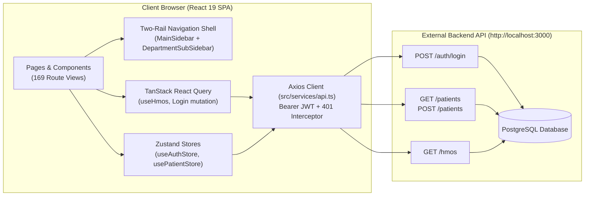
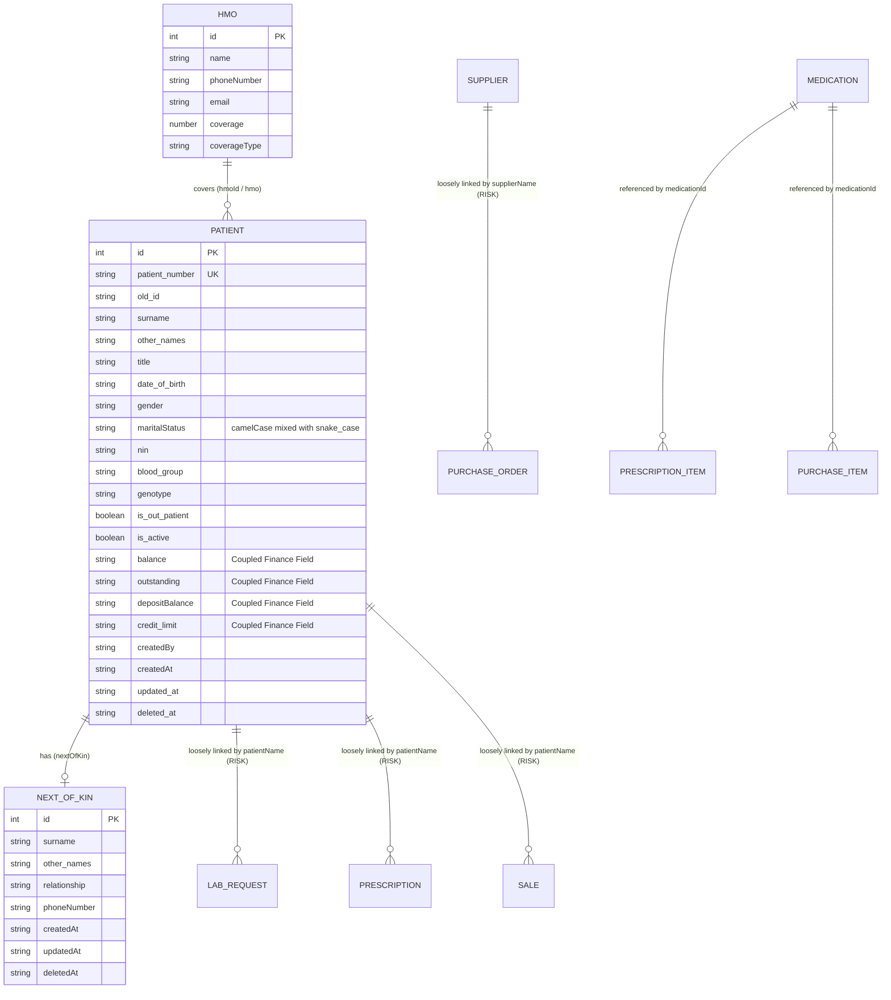
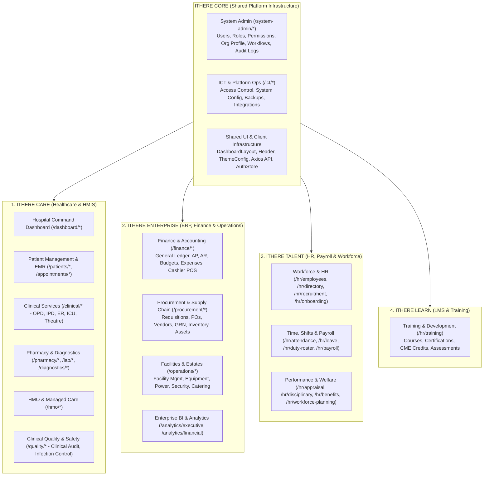
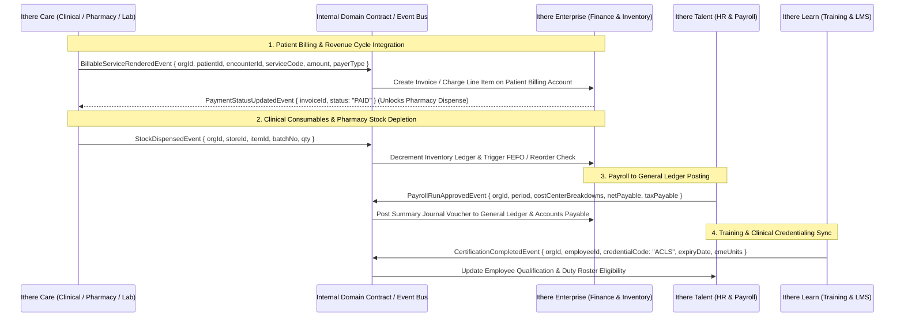
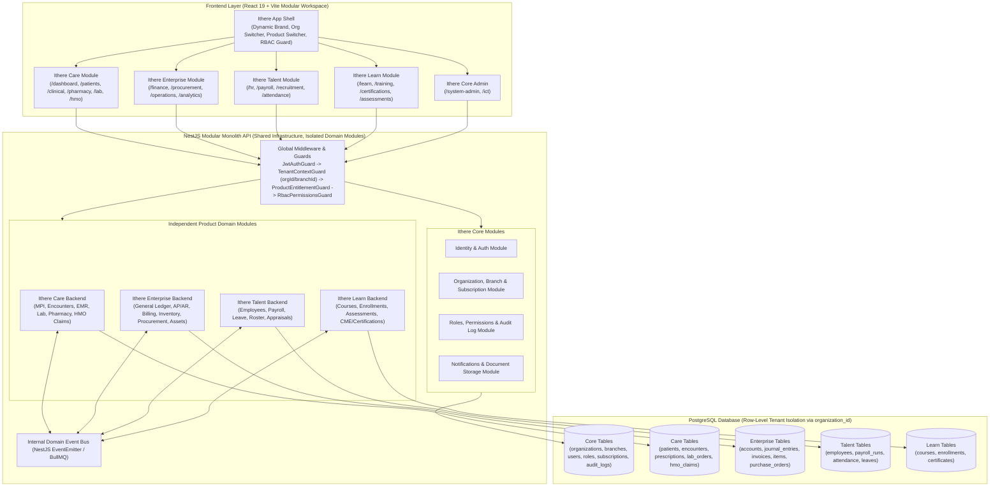

# ITHERE TECHNOLOGY GROUP — MULTI-PRODUCT ARCHITECTURE READINESS AUDIT

**Document ID:** `ITHERE-ARCH-AUDIT-2026-001`  
**Prepared For:** Ithere Technology Group — Project Ownership & Engineering Leadership  
**Target Codebase:** `myClinical` Enterprise HMIS (`/home/kennytech/workdone/myclinical`)  
**Audit Date:** November 6, 2026  
**Audit Scope:** Full Technical & Architectural Readiness Assessment for Multi-Product Evolution  

---

## 1. Executive Summary

### 1.1 Context and Strategic Objective
**Ithere Technology Group** is currently developing **myClinical**, a comprehensive Hospital Management Information System (HMIS), as the foundational application for a broader multi-product enterprise software ecosystem:

> **One platform. Multiple independent products. Shared infrastructure. Flexible subscriptions.**

The planned product portfolio comprises:
1. **Ithere Care** — Healthcare management, HMIS, EMR, pharmacy, laboratory, diagnostics, HMO/insurance, and clinical operations.
2. **Ithere Enterprise** — Business management, ERP, general ledger accounting, accounts payable/receivable, procurement, supply chain, asset management, and facility operations.
3. **Ithere Talent** — Human resource management, payroll processing, recruitment (ATS), attendance, shift rostering, performance appraisal, and workforce planning.
4. **Ithere Learn** — Learning management, continuing education (CME), certification tracking, training assessments, and educational solutions.
5. **Ithere Systems** — Customized enterprise solutions, cross-product integrations, and tailored multi-product deployments.

### 1.2 Overall Architecture Readiness Score: **44% (Foundation Stage — Safe to Continue with Targeted Guardrails)**

| Architectural Dimension | Weight | Score (0–100%) | Weighted Contribution | Primary Status |
| :--- | :---: | :---: | :---: | :---: |
| **1. UI Shell, Design System & Navigation Hierarchy** | 15% | 78% | 11.7% | **PARTIALLY READY** |
| **2. Frontend Module & Domain Taxonomy** | 15% | 62% | 9.3% | **PARTIALLY READY** |
| **3. API Client, State Management & Service Boundaries** | 15% | 48% | 7.2% | **PARTIALLY READY** |
| **4. Authentication & Identity Management** | 10% | 45% | 4.5% | **PARTIALLY READY** |
| **5. Permissions & Role-Based Access Control (RBAC)** | 10% | 30% | 3.0% | **PARTIALLY READY / RISK** |
| **6. Database Schema & Entity Contracts (via DTOs/Types)** | 10% | 42% | 4.2% | **PARTIALLY READY / RISK** |
| **7. Multi-Tenancy & Organization Isolation** | 10% | 15% | 1.5% | **NOT IMPLEMENTED** |
| **8. Product/Module Activation & Subscription Readiness** | 10% | 15% | 1.5% | **NOT IMPLEMENTED** |
| **9. Cross-Product Integration & Security Governance** | 5% | 22% | 1.1% | **PARTIALLY READY** |
| **TOTAL WEIGHTED READINESS** | **100%** | — | **44.0%** | **FOUNDATION STAGE** |

### 1.3 Key Audit Conclusions
1. **Can we safely continue building the existing HMIS without a rewrite?**  
   **Yes.** The current React 19 + TypeScript + Vite + Ant Design + Tailwind CSS stack and the external NestJS/PostgreSQL API architecture are modern, appropriate, and capable of evolving into the Ithere multi-product ecosystem. No rewrite or framework replacement is needed.
2. **Why is the codebase already a strong conceptual blueprint for Ithere?**  
   The 13-department navigation taxonomy in [`src/navigation/navigationConfig.ts`](file:///home/kennytech/workdone/myclinical/src/navigation/navigationConfig.ts) already contains explicit domain modules for Finance/ERP (`/finance/*`), Procurement & Supply Chain (`/procurement/*`), HR & Payroll (`/hr/*`), Training (`/hr/training`), Facilities/Operations (`/operations/*`), Analytics (`/analytics/*`), and System Administration (`/system-admin/*`). Because **144 of the 169 pages (85.2%)** are currently structured staging placeholders ([`HmisPlaceholderPage.tsx`](file:///home/kennytech/workdone/myclinical/src/components/ui/HmisPlaceholderPage.tsx)) and only **25 pages (14.8%)** contain custom implementation logic, the project is at the **ideal inflection point** to establish clean domain and tenant boundaries *before* deep business logic is written across all 144 placeholder pages.
3. **What is the most important immediate priority?**  
   Standardizing data contracts (introducing `organizationId` / `branchId` readiness, decoupling patient demographics from financial balances, and replacing hardcoded string names like `patientName` with foreign keys `patientId`), enforcing the existing `roles` fields in routes and sidebars, and eliminating copy-pasted page duplication between `src/pages/patients/` and `src/pages/appointments/`.

---

## 2. Existing Project Architecture

### 2.1 Repository Scope and Architectural Topology
A critical finding verified directly from the workspace is the physical separation between the frontend repository and the backend service:
- **Current Repository (`/home/kennytech/workdone/myclinical`)**: Contains the **Frontend Single-Page Application (SPA)** (`"name": "myclinical"` in [`package.json`](file:///home/kennytech/workdone/myclinical/package.json#L1-L5)).
- **Backend Service (`http://localhost:3000`)**: The NestJS + PostgreSQL backend runs as a separate service consumed over REST via Axios ([`src/services/api.ts`](file:///home/kennytech/workdone/myclinical/src/services/api.ts#L4-L6)). Its entity schemas and API contracts are reflected in the frontend TypeScript interfaces ([`src/types/`](file:///home/kennytech/workdone/myclinical/src/types)) and service layers ([`src/services/`](file:///home/kennytech/workdone/myclinical/src/services)).



### 2.2 Application Shell and Layout Architecture
The application uses a three-level hierarchical workspace shell implemented in [`src/layouts/DashboardLayouts.tsx`](file:///home/kennytech/workdone/myclinical/src/layouts/DashboardLayouts.tsx#L16-L91):
- **Level 1 — Primary Department Rail ([`MainSidebar.tsx`](file:///home/kennytech/workdone/myclinical/src/components/navigation/MainSidebar.tsx))**: Displays the 13 top-level hospital directorates/departments defined in `HMIS_DEPARTMENTS`, with collapse/expand support and department search (`⌘D`).
- **Level 2 — Contextual Module Sub-Sidebar ([`DepartmentSubSidebar.tsx`](file:///home/kennytech/workdone/myclinical/src/components/navigation/DepartmentSubSidebar.tsx))**: Dynamically resolves the active department from the URL path via [`findDepartmentByPath()`](file:///home/kennytech/workdone/myclinical/src/navigation/navigationConfig.ts#L1567-L1655) and renders grouped functional modules with search and badge metadata.
- **Level 3 — Operational Workspace & Page Tabs (`<Outlet />` + [`Header.tsx`](file:///home/kennytech/workdone/myclinical/src/components/Header.tsx))**: Renders sticky breadcrumbs, global search input, dark/light theme switcher, notification bell, user profile menu, and in-page operational tabs.

> [!NOTE]
> Legacy navigation components [`src/components/Sidebar.tsx`](file:///home/kennytech/workdone/myclinical/src/components/Sidebar.tsx) and [`src/components/module/SideBarModule.ts`](file:///home/kennytech/workdone/myclinical/src/components/module/SideBarModule.ts) still exist in the repository from an earlier single-sidebar iteration, though [`DashboardLayouts.tsx`](file:///home/kennytech/workdone/myclinical/src/layouts/DashboardLayouts.tsx) now exclusively mounts `MainSidebar` and `DepartmentSubSidebar`.

### 2.3 Implementation Maturity Breakdown (Actual vs. Staged)
Inspecting all **169 `.tsx` page files** under `src/pages/` reveals three distinct implementation tiers:

| Implementation Tier | Page Count | % of Pages | Description & Verification |
| :--- | :---: | :---: | :--- |
| **Tier 1: Live API-Integrated Pages** | **9** | **5.3%** | [`Login.tsx`](file:///home/kennytech/workdone/myclinical/src/pages/auth/Login.tsx), [`Patients.tsx`](file:///home/kennytech/workdone/myclinical/src/pages/patients/Patients.tsx), [`CreatePatientDashboard.tsx`](file:///home/kennytech/workdone/myclinical/src/pages/patients/CreatePatientDashboard.tsx), [`CreateNewPatient.tsx`](file:///home/kennytech/workdone/myclinical/src/pages/patients/CreateNewPatient.tsx), [`CreateOPDPatient.tsx`](file:///home/kennytech/workdone/myclinical/src/pages/patients/CreateOPDPatient.tsx), plus 4 duplicated files in `src/pages/appointments/` ([`Home.tsx`](file:///home/kennytech/workdone/myclinical/src/pages/appointments/Home.tsx), etc.) that call `/auth/login`, `/patients`, and `/hmos`. |
| **Tier 2: Interactive Mock-Data Pages** | **16** | **9.5%** | [`HospitalDashboard.tsx`](file:///home/kennytech/workdone/myclinical/src/pages/dashboard/HospitalDashboard.tsx), [`PatientDashboard.tsx`](file:///home/kennytech/workdone/myclinical/src/pages/patients/PatientDashboard.tsx) (and its duplicate in `appointments/`), 6 Laboratory pages in [`src/pages/lab/`](file:///home/kennytech/workdone/myclinical/src/pages/lab) backed by [`lab.mock.ts`](file:///home/kennytech/workdone/myclinical/src/data/lab.mock.ts), and 7 Pharmacy pages in [`src/pages/pharmacy/`](file:///home/kennytech/workdone/myclinical/src/pages/pharmacy) backed by [`pharmacy.ts`](file:///home/kennytech/workdone/myclinical/src/data/pharmacy.ts). |
| **Tier 3: Staged Placeholder Pages** | **144** | **85.2%** | Render [`HmisPlaceholderPage`](file:///home/kennytech/workdone/myclinical/src/components/ui/HmisPlaceholderPage.tsx) with rich domain metadata (tabs, KPI cards, capability descriptions, and workflow stages) but no domain state or API integration yet. |
| **Total Page Views** | **169** | **100%** | Mounted across 170+ `<Route>` declarations in [`src/routes/AppRoutes.tsx`](file:///home/kennytech/workdone/myclinical/src/routes/AppRoutes.tsx). |

---

## 3. Current Technology Stack

Verified from [`package.json`](file:///home/kennytech/workdone/myclinical/package.json), [`vite.config.ts`](file:///home/kennytech/workdone/myclinical/vite.config.ts), [`tailwind.config.js`](file:///home/kennytech/workdone/myclinical/tailwind.config.js), and [`tsconfig.app.json`](file:///home/kennytech/workdone/myclinical/tsconfig.app.json):

| Layer | Technology | Version | Current Usage & Ecosystem Suitability | Status |
| :--- | :--- | :--- | :--- | :---: |
| **Core UI Framework** | React + React DOM | `^19.2.0` | Modern functional components and hooks. Suitable for all Ithere products. | **READY** |
| **Language** | TypeScript | `~5.9.3` | Strict mode enabled in [`tsconfig.app.json`](file:///home/kennytech/workdone/myclinical/tsconfig.app.json#L18). Some `any` usages weaken type safety. | **READY** |
| **Build Tooling** | Vite + `@vitejs/plugin-react-swc` | `^7.3.1` | Fast SWC-based compilation. Currently builds a single monolithic bundle without lazy route splitting. | **PARTIALLY READY** |
| **Routing** | `react-router-dom` | `^7.13.1` | Declarative `<BrowserRouter>` in [`AppRoutes.tsx`](file:///home/kennytech/workdone/myclinical/src/routes/AppRoutes.tsx). Note: `@types/react-router-dom` `^5.3.3` is installed in `devDependencies` (unnecessary in v7, which ships its own types). | **PARTIALLY READY** |
| **UI Component Library** | Ant Design (`antd`) | `^6.3.1` | Used for `Table`, `Form`, `Select`, `Steps`, `Drawer`, `Modal`, `Tag`, `Button`, `ConfigProvider`. | **READY** |
| **Styling & Theme** | Tailwind CSS + PostCSS + `jiti` | `3` | Centralized emerald color tokens in [`src/theme/themeConfig.ts`](file:///home/kennytech/workdone/myclinical/src/theme/themeConfig.ts) shared between Tailwind and AntD `ConfigProvider` (Light & Dark modes). | **READY** |
| **Server State** | `@tanstack/react-query` | `^5.90.21` | Initialized in [`src/app/queryClient.ts`](file:///home/kennytech/workdone/myclinical/src/app/queryClient.ts), used only in `Login.tsx` and `useHmos.ts`. | **PARTIALLY READY** |
| **Client State** | `zustand` | `^5.0.11` | Used in [`auth.store.ts`](file:///home/kennytech/workdone/myclinical/src/store/auth.store.ts) (persisted) and [`patient.store.ts`](file:///home/kennytech/workdone/myclinical/src/store/patient.store.ts). | **PARTIALLY READY** |
| **HTTP Client** | `axios` | `^1.13.5` | Configured in [`src/services/api.ts`](file:///home/kennytech/workdone/myclinical/src/services/api.ts) with request JWT injection and 401 redirect. | **PARTIALLY READY** |
| **Charts & Visualization** | `recharts` | `^3.7.0` | Used in `HospitalDashboard`, `PatientDashboard`, `PharmacyDashboard`, and `SalesAnalytics`. | **READY** |
| **Icons & Utilities** | `lucide-react`, `dayjs`, `react-hot-toast` | `^0.575.0`, `^1.11.19`, `^2.6.0` | Clean utility wrapper for `dayjs` (`isBetween` plugin) in [`src/utils/dayJs.ts`](file:///home/kennytech/workdone/myclinical/src/utils/dayJs.ts). | **READY** |
| **Backend & Database** | NestJS + PostgreSQL (External) | REST API | Consumed at `http://localhost:3000`. | **PARTIALLY READY** |

---

## 4. Existing Application Module Structure

### 4.1 Directory Organization
```text
src/
├── app/                # React Query client instance (queryClient.ts)
├── assets/             # Static SVG assets
├── components/         # UI, navigation, modal, and domain filter components
│   ├── Lab/            # Lab-specific filters, QueueItem, StatCard, TableRow
│   ├── Patients/       # PatientsFilter.tsx
│   ├── modal/          # LabResultModal, LabReportModal, PatientProfile, OpdPatientProfile
│   ├── module/         # Legacy SideBarModule.ts (unused by DashboardLayout)
│   ├── navigation/     # MainSidebar.tsx (Level 1), DepartmentSubSidebar.tsx (Level 2)
│   ├── pharmacy/       # Pharmacy filters and SalesAnalytics
│   ├── skeletons/      # DashboardCardSkeleton, TableSkeleton
│   ├── ui/             # CustomDatePicker, DateRangePicker, HmisPlaceholderPage, SectionHeader, StatsCard
│   ├── Header.tsx      # Top bar with breadcrumbs, search, theme toggle, user profile
│   └── Sidebar.tsx     # Legacy sidebar component (unused by DashboardLayout)
├── data/               # Static mock datasets (patients.ts, appointments.ts, lab.mock.ts, pharmacy.ts)
├── features/           # Feature hooks/API (auth/authApi.ts, hmo/useHmos.ts)
├── layouts/            # DashboardLayouts.tsx (Two-sidebar + Header + Outlet shell)
├── navigation/         # navigationConfig.ts (13 departments, 150+ nav items, path resolver)
├── pages/              # 169 route page components grouped into 17 folders
├── routes/             # AppRoutes.tsx (all routes), ProtectedRoutes.tsx (auth/role guard)
├── services/           # Axios instance (api.ts) and domain services (auth, patient, hmo)
├── store/              # Zustand stores (auth.store.ts, patient.store.ts)
├── theme/              # AntD + Tailwind color tokens (themeConfig.ts)
├── types/              # TypeScript interfaces & DTOs (patients, hmo, lab, pharmacy)
└── utils/              # dayJs.ts, useTabActions.ts, QuickActionCard.tsx, GlobalButtonStyles.tsx
```

### 4.2 Audit Findings on Application Structure & Modularity

#### Finding A1: Competing Frontend Architecture Patterns (`services/` + `store/` vs. `features/`)
- **Classification:** **PARTIALLY READY**
- **Priority:** High | **Timing:** Immediate (Phase 1)
- **What Currently Exists:**  
  The codebase has two overlapping patterns for API calls and state management:
  1. **Pattern A (`features/` + React Query):** [`src/features/auth/authApi.ts`](file:///home/kennytech/workdone/myclinical/src/features/auth/authApi.ts) and [`src/features/hmo/useHmos.ts`](file:///home/kennytech/workdone/myclinical/src/features/hmo/useHmos.ts) use `@tanstack/react-query`.
  2. **Pattern B (`services/` + Zustand store):** [`src/services/patient.service.ts`](file:///home/kennytech/workdone/myclinical/src/services/patient.service.ts) is wrapped by [`src/store/patient.store.ts`](file:///home/kennytech/workdone/myclinical/src/store/patient.store.ts), manually managing `loading`, `error`, and `patients[]` in Zustand.
  3. **Duplication:** Login API logic is duplicated in both [`src/services/auth.service.ts`](file:///home/kennytech/workdone/myclinical/src/services/auth.service.ts#L8-L15) and [`src/features/auth/authApi.ts`](file:///home/kennytech/workdone/myclinical/src/features/auth/authApi.ts#L3-L9). Similarly, `Patient` and `Hmo` types are duplicated in [`src/types/patients.ts`](file:///home/kennytech/workdone/myclinical/src/types/patients.ts) and [`src/types/patients/fetchPatientDto.ts`](file:///home/kennytech/workdone/myclinical/src/types/patients/fetchPatientDto.ts).
- **What Is Missing:** A single, consistent data-fetching convention (React Query for server cache + Zustand strictly for client/session state).
- **Why It Matters:** As 144 placeholder pages are connected to backend endpoints, mixing manual Zustand array stores with React Query will cause cache invalidation bugs, stale data across modules, and duplicated boilerplate.
- **Recommended Action:** Standardize on `@tanstack/react-query` hooks calling `src/services/*.service.ts` for all server state, reserving Zustand (`src/store/`) strictly for session/identity, active organization context, and UI preferences.

#### Finding A2: Eager Monolithic Route Loading & Code Duplication
- **Classification:** **RISK**
- **Priority:** High | **Timing:** Phase 1
- **What Currently Exists:**
  1. [`src/routes/AppRoutes.tsx`](file:///home/kennytech/workdone/myclinical/src/routes/AppRoutes.tsx#L1-L195) statically imports all **169 page components** at the top of a single file. Every user login downloads the code for all 13 departments.
  2. Four files in [`src/pages/appointments/`](file:///home/kennytech/workdone/myclinical/src/pages/appointments) (`CreateNewPatient.tsx`, `CreateOPDPatient.tsx`, `CreatePatientDashboard.tsx`, `PatientDashboard.tsx`) are copy-pasted duplicates of the exact same files in [`src/pages/patients/`](file:///home/kennytech/workdone/myclinical/src/pages/patients). Furthermore, [`src/pages/appointments/Home.tsx`](file:///home/kennytech/workdone/myclinical/src/pages/appointments/Home.tsx#L30-L37) reads `localStorage.getItem("patient-tab")` (colliding with `Patients.tsx`) and displays `usePatientStore().patients` instead of appointments.
  3. Broken internal navigation links exist in [`src/pages/lab/LabDashboard.tsx`](file:///home/kennytech/workdone/myclinical/src/pages/lab/LabDashboard.tsx#L130-L160) and [`src/pages/lab/NewLabRequests.tsx`](file:///home/kennytech/workdone/myclinical/src/pages/lab/NewLabRequests.tsx#L203-L220), which call `navigate("/pharmacy-diagnostics/lab-requests")` while [`AppRoutes.tsx`](file:///home/kennytech/workdone/myclinical/src/routes/AppRoutes.tsx#L282-L287) mounts those routes at `/lab/requests`, `/lab/queue`, and `/lab/results` (causing silent fallback redirects to `/login` via `<Route path="*" element={<Navigate to="/login" replace />} />`).
- **What Is Missing:** Route-level lazy loading (`React.lazy` + `<Suspense>`), modular route registries per product/department, and removal of duplicated appointment/patient files.
- **Why It Matters:** When Ithere Enterprise, Ithere Talent, and Ithere Learn grow into full products, a single eagerly-loaded `AppRoutes.tsx` will severely degrade bundle size and prevent independent product packaging.
- **Recommended Action:** Refactor `AppRoutes.tsx` to use modular route groups with `React.lazy()`, fix the `/lab/*` navigation links, and point appointment creation routes to shared components or dedicated appointment views.

---

## 5. Current Database Architecture

*(Evaluated via the ORM/API entity contracts, DTOs, and response schemas in [`src/types/`](file:///home/kennytech/workdone/myclinical/src/types) and [`src/services/`](file:///home/kennytech/workdone/myclinical/src/services))*

### 5.1 Current Entity Inventory & Relationships



### 5.2 Database & Entity Architecture Findings

#### Finding G1: Inconsistent Column Naming Conventions (`snake_case` vs. `camelCase`)
- **Classification:** **PARTIALLY READY**
- **Priority:** Medium | **Timing:** Phase 1 (Standardize on new entities)
- **What Currently Exists:** In [`src/types/patients.ts`](file:///home/kennytech/workdone/myclinical/src/types/patients.ts#L21-L77), the `Patient` entity returned by the backend mixes `snake_case` (`patient_number`, `other_names`, `date_of_birth`, `phone_number`, `blood_group`, `is_out_patient`, `updated_at`, `deleted_at`) with `camelCase` (`maritalStatus`, `hasEnrolledOnline`, `depositBalance`, `nextAppointment`, `createdBy`, `createdAt`).
- **What Is Missing:** Consistent DTO serialization rules in NestJS (or consistent ORM column mapping) so API payloads follow a single convention across all modules.
- **Why It Matters:** Cross-product integrations (e.g., Ithere Care to Ithere Enterprise) become error-prone when developers must guess whether timestamp or foreign key fields use `updated_at` or `updatedAt`.
- **Recommended Action:** Keep existing `Patient` fields intact to avoid breaking working forms, but enforce a strict `camelCase` JSON DTO standard (with `snake_case` database columns mapped via ORM `@Column({ name: '...' })`) for all new entities.

#### Finding G2: Absence of `organizationId` and `branchId` on Core Entities
- **Classification:** **RISK**
- **Priority:** Critical | **Timing:** Phase 1 (Backend Schema Preparation)
- **What Currently Exists:** None of the entities (`Patient`, `NextOfKin`, `Hmo`, `Medication`, `Prescription`, `PurchaseOrder`, `Sale`, `Supplier`, `LabRequest`) include an `organizationId` (tenant identifier) or `branchId` / `facilityId` (location identifier). Furthermore, `patient_number` and `nin` assume a single global namespace.
- **What Is Missing:** Nullable-first (or default-seeded) `organization_id` and `branch_id` foreign keys on all operational tables, with composite unique constraints (e.g., `UNIQUE(organization_id, patient_number)`).
- **Why It Matters:** Without `organization_id` at the entity level, a multi-tenant deployment of Ithere Care or Ithere Enterprise cannot isolate one customer's data from another's.
- **Recommended Action:** When evolving the backend schema, add `organization_id` (defaulting to a seeded primary organization ID for the current hospital deployment) and `branch_id` to all core tables so existing single-hospital queries continue to work seamlessly while preparing for multi-organization isolation.

#### Finding G3: Tight Coupling of Financial Ledger Fields Inside the `Patient` Entity
- **Classification:** **RISK**
- **Priority:** High | **Timing:** Phase 2 (When connecting Finance/Billing)
- **What Currently Exists:** [`src/types/patients.ts`](file:///home/kennytech/workdone/myclinical/src/types/patients.ts#L56-L61) embeds `balance`, `outstanding`, `depositBalance`, `credit_limit`, and `credit_limit_expiry_date` directly on the `Patient` entity.
- **What Is Missing:** Separation between the clinical **Patient Master Index (`Ithere Care`)** and the **Customer/Patient Billing Account (`Ithere Enterprise` / Billing module)**.
- **Why It Matters:** In the Ithere ecosystem, **Ithere Enterprise** handles accounting, receivables, credit limits, and customer balances for *both* hospitals (patients/HMOs) and non-healthcare businesses (corporate clients/customers). Embedding financial ledger balances directly inside the `patients` table prevents reusable accounting workflows and creates race conditions during concurrent billing transactions.
- **Recommended Action:** Retain the read-only display fields on `Patient` for backward compatibility right now, but design the backend `BillingAccount` / `LedgerAccount` entity as a separate table linked via `party_id` / `patient_id` when implementing `/finance/*` backend modules.

#### Finding G4: Denormalized String References in Lab & Pharmacy Contracts
- **Classification:** **PARTIALLY READY / RISK**
- **Priority:** High | **Timing:** Phase 1 (Before backend integration of Lab & Pharmacy)
- **What Currently Exists:** In [`src/types/lab.ts`](file:///home/kennytech/workdone/myclinical/src/types/lab.ts#L6-L41) and [`src/types/pharmacy.ts`](file:///home/kennytech/workdone/myclinical/src/types/pharmacy.ts#L26-L96), entities use raw names (`patientName: string`, `doctorName: string`, `supplierName: string`, `technician: string`) instead of relational foreign keys (`patientId: number`, `doctorId: number`, `supplierId: number`).
- **What Is Missing:** Foreign key IDs (`patientId`, `prescriberId`, `supplierId`, `encounterId`) alongside display DTO fields.
- **Why It Matters:** Referential integrity across EMR, Lab, Pharmacy, and Billing requires immutable IDs, not mutable display strings (`"John Doe"`).
- **Recommended Action:** Before wiring `/lab/*` and `/pharmacy/*` pages to NestJS endpoints, update [`src/types/lab.ts`](file:///home/kennytech/workdone/myclinical/src/types/lab.ts) and [`src/types/pharmacy.ts`](file:///home/kennytech/workdone/myclinical/src/types/pharmacy.ts) to require `patientId`, `doctorId`, and `supplierId`.

---

## 6. Authentication and Authorization Assessment

### 6.1 Current Implementation Verification
1. **Login Flow ([`src/pages/auth/Login.tsx`](file:///home/kennytech/workdone/myclinical/src/pages/auth/Login.tsx#L20-L51))**:
   - Submits `{ username, password }` to `POST /auth/login`.
   - Extracts `res.data.user` and `res.data.access_token` and writes them to `useAuthStore.getState().setAuth(user, token)`.
2. **Session Persistence ([`src/store/auth.store.ts`](file:///home/kennytech/workdone/myclinical/src/store/auth.store.ts#L11-L26))**:
   - Uses `zustand/middleware` `persist` to store `{ user: any, token: string | null }` in `localStorage` under the key `"auth-storage"`.
3. **API Request & Response Interceptors ([`src/services/api.ts`](file:///home/kennytech/workdone/myclinical/src/services/api.ts#L8-L40))**:
   - Injects `Authorization: Bearer ${token}` on all requests except `/auth/login` and `/auth/register`.
   - On HTTP `401`, calls `useAuthStore.getState().logout()` and forces a hard page reload to `window.location.href = "/login"`.
4. **Route Guard ([`src/routes/ProtectedRoutes.tsx`](file:///home/kennytech/workdone/myclinical/src/routes/ProtectedRoutes.tsx#L5-L15))**:
   - Checks `if (!token) return <Navigate to="/login" replace />;`.
   - Supports optional role checking: `if (allowedRoles && !allowedRoles.includes(user?.role)) return <Navigate to="/unauthorized" replace />;`.

### 6.2 Authentication & Identity Findings

#### Finding C1: Untyped User Context & Single-App Session Model
- **Classification:** **PARTIALLY READY**
- **Priority:** High | **Timing:** Phase 1
- **What Currently Exists:** `user: any` in [`src/store/auth.store.ts`](file:///home/kennytech/workdone/myclinical/src/store/auth.store.ts#L4). [`Header.tsx`](file:///home/kennytech/workdone/myclinical/src/components/Header.tsx#L135-L155) and [`MainSidebar.tsx`](file:///home/kennytech/workdone/myclinical/src/components/navigation/MainSidebar.tsx#L268-L273) fallback to hardcoded `"Dr. Alex"` and `"Administrator"` if `user?.name` or `user?.role` is missing.
- **What Is Missing:**
  - A strongly-typed `AuthenticatedUser` interface (`id`, `username`, `email`, `fullName`, `role`, `roles[]`, `permissions[]`, `departmentId`, `organizationId`, `branchId`, `activeProducts[]`).
  - Refresh token rotation or token expiry validation (`exp` claim check).
  - Environment variable alignment: [`.env`](file:///home/kennytech/workdone/myclinical/.env#L1) defines `API_URL = "http://localhost:3000"`, whereas [`src/services/api.ts`](file:///home/kennytech/workdone/myclinical/src/services/api.ts#L5) reads `import.meta.env.VITE_API_URL`.
- **Why It Matters:** For one Ithere account to access multiple products and organizations, the session payload must carry identity, organization membership, active branch, and product entitlements in a strongly typed structure.
- **Recommended Action:** Define a typed `AuthUser` & `SessionContext` interface in `src/types/auth.ts` without breaking the current `/auth/login` response structure, and add `VITE_API_URL` to `.env`.

### 6.3 Permissions & Access Control Findings

#### Finding D1: RBAC Scaffolding Exists in Code but Is Not Enforced
- **Classification:** **RISK**
- **Priority:** Critical | **Timing:** Immediate (Phase 1)
- **What Currently Exists:**
  - [`ProtectedRoutes.tsx`](file:///home/kennytech/workdone/myclinical/src/routes/ProtectedRoutes.tsx#L10-L12) implements `allowedRoles.includes(user?.role)`.
  - [`navigationConfig.ts`](file:///home/kennytech/workdone/myclinical/src/navigation/navigationConfig.ts#L72-L90) defines `roles?: string[]` on both `DepartmentConfig` and `NavItem`.
  - **However:**
    1. In [`AppRoutes.tsx`](file:///home/kennytech/workdone/myclinical/src/routes/AppRoutes.tsx#L213), `<ProtectedRoute>` is called without `allowedRoles`, and zero child routes use `<ProtectedRoute allowedRoles={...}>`.
    2. In [`navigationConfig.ts`](file:///home/kennytech/workdone/myclinical/src/navigation/navigationConfig.ts), zero departments or nav items actually specify a `roles` array.
    3. Neither [`MainSidebar.tsx`](file:///home/kennytech/workdone/myclinical/src/components/navigation/MainSidebar.tsx#L34-L43) nor [`DepartmentSubSidebar.tsx`](file:///home/kennytech/workdone/myclinical/src/components/navigation/DepartmentSubSidebar.tsx#L36-L51) filters items by `user.role`!
- **What Is Missing:**
  - Multi-level permission evaluation: **Organization -> Product -> Module/Department -> Role -> Action (`view`, `create`, `edit`, `approve`, `delete`)**.
  - Filtering of `MainSidebar` and `DepartmentSubSidebar` based on the authenticated user's roles/permissions and active product subscriptions.
  - Support for multiple roles per user (`user.roles: string[]` in addition to primary `user.role`).
- **Why It Matters:** Right now, any logged-in staff member (e.g., a receptionist or lab technician) can navigate to `/finance/general-ledger`, `/hr/payroll`, `/clinical/emr`, and `/system-admin/permissions`. In a healthcare and multi-product environment, strict role and department isolation is mandatory.
- **Recommended Action:** Add a lightweight `canAccess(user, { roles, permissions, product })` helper used by `MainSidebar`, `DepartmentSubSidebar`, and `ProtectedRoute`, while allowing a `SUPER_ADMIN` / `ADMIN` fallback so existing development accounts retain full access during development.

---

## 7. Multi-Tenancy Readiness

### 7.1 Current Multi-Tenancy Status
- **Classification:** **NOT IMPLEMENTED** (Single-Hospital Instance Assumption)
- **Priority:** High (Foundation in Phase 1; Full Enforcement in Phase 2)

### 7.2 Detailed Evaluation Against Multi-Tenancy Requirements

| Multi-Tenancy Capability | Current State in Codebase | Target Ithere Design | Readiness |
| :--- | :--- | :--- | :---: |
| **Multiple Organizations (Tenants)** | Not implemented. Assumes a single hospital (`myClinical`). | Shared database, shared schema with mandatory `organization_id` column on all tenant-owned tables (Row-Level Tenant Isolation). | **NOT IMPLEMENTED** |
| **Multiple Branches / Locations** | UI placeholder exists in [`HospitalConfig.tsx`](file:///home/kennytech/workdone/myclinical/src/pages/system-admin/HospitalConfig.tsx#L15) (`"Multi-Campus & Branch Locations"` tab), but no `branchId` exists in stores, headers, or DTOs. | `Branch` / `Facility` entity belonging to an `Organization`, with active `branchId` selector in Header and API context. | **PARTIALLY READY (UI Concept Only)** |
| **Departments & Business Units** | Hardcoded in [`navigationConfig.ts`](file:///home/kennytech/workdone/myclinical/src/navigation/navigationConfig.ts) (`HMIS_DEPARTMENTS`) and mocked as strings in [`patients.ts`](file:///home/kennytech/workdone/myclinical/src/data/patients.ts#L18). UI placeholder in [`DepartmentConfig.tsx`](file:///home/kennytech/workdone/myclinical/src/pages/system-admin/DepartmentConfig.tsx). | Dynamic `Department` / `CostCenter` table scoped by `organization_id` and `branch_id`. | **PARTIALLY READY** |
| **Organization-Specific Configs & Branding** | Branding ("myClinical", `/logo.png`, emerald theme) is hardcoded in [`MainSidebar.tsx`](file:///home/kennytech/workdone/myclinical/src/components/navigation/MainSidebar.tsx#L64-L82) and [`Login.tsx`](file:///home/kennytech/workdone/myclinical/src/pages/auth/Login.tsx#L75-L80). | Organization profile object loaded on session init (`organization.name`, `organization.logoUrl`, `organization.currency`, `organization.theme`). | **PARTIALLY READY** |
| **Data Isolation Between Customers** | No tenant header or token scoping verified in [`api.ts`](file:///home/kennytech/workdone/myclinical/src/services/api.ts). | JWT payload carries `organizationId`; backend NestJS Guard/Interceptor automatically scopes all ORM queries by `organizationId`. | **NOT IMPLEMENTED** |
| **Centralized Platform Administration** | `/system-admin/*` is tenant-level hospital admin, not cross-tenant Ithere Platform Admin. | Separate `PLATFORM_SUPER_ADMIN` scope for Ithere Technology Group to provision organizations and product subscriptions. | **FUTURE REQUIREMENT** |

### 7.3 Minimum Non-Breaking Changes Required for Multi-Organization Evolution
To avoid over-engineering now while preventing a painful database rewrite later:
1. **Do NOT implement separate databases per tenant or complex schema-per-tenant routing right now.**
2. **Use a single PostgreSQL schema with `organization_id` (and optional `branch_id`)** on all tables.
3. Seed a default Organization (`id = 1`, `"Default Hospital"`) in the backend so the current hospital installation works without any UI changes, while every new table created in NestJS includes `organization_id` from day one.
4. On the frontend, include an optional `X-Organization-Id` / `X-Branch-Id` header in [`src/services/api.ts`](file:///home/kennytech/workdone/myclinical/src/services/api.ts) sourced from `useAuthStore` when available.

---

## 8. Shared Infrastructure Assessment (`Ithere Core` Candidates)

Per Section 4.F of the assignment, each of the 12 candidate shared services has been inspected against the actual codebase and classified:

| # | Shared Service Candidate | Audit Classification | What Currently Exists in Codebase | What Is Missing for `Ithere Core` | Priority & Timing |
| :-: | :--- | :---: | :--- | :--- | :--- |
| **1** | **Authentication & Identity** | **Implemented but requires improvement** (`PARTIALLY READY`) | [`Login.tsx`](file:///home/kennytech/workdone/myclinical/src/pages/auth/Login.tsx), [`auth.store.ts`](file:///home/kennytech/workdone/myclinical/src/store/auth.store.ts), [`api.ts`](file:///home/kennytech/workdone/myclinical/src/services/api.ts) (JWT Bearer + 401 handler). | Typed user model, refresh tokens, `/auth/me` profile hydration, organization membership context, and product-neutral login branding. | **High** (Phase 1) |
| **2** | **Organization & Tenant Management** | **Partially implemented** (`PARTIALLY READY`) | UI staging screens in [`HospitalConfig.tsx`](file:///home/kennytech/workdone/myclinical/src/pages/system-admin/HospitalConfig.tsx) and [`DepartmentConfig.tsx`](file:///home/kennytech/workdone/myclinical/src/pages/system-admin/DepartmentConfig.tsx). | Backend `Organization`, `Branch`, and `Department` entities, plus frontend organization context store. | **High** (Phase 1/2) |
| **3** | **User Management** | **Partially implemented** (`PARTIALLY READY`) | UI staging screen in [`UserManagement.tsx`](file:///home/kennytech/workdone/myclinical/src/pages/system-admin/UserManagement.tsx) and [`UserAccessManagement.tsx`](file:///home/kennytech/workdone/myclinical/src/pages/ict/UserAccessManagement.tsx). | Live CRUD tables, API service (`user.service.ts`), password reset, and user-to-organization assignment. | **High** (Phase 1) |
| **4** | **Role & Permission Management** | **Partially implemented** (`PARTIALLY READY`) | [`ProtectedRoutes.tsx`](file:///home/kennytech/workdone/myclinical/src/routes/ProtectedRoutes.tsx), `roles?: string[]` in [`navigationConfig.ts`](file:///home/kennytech/workdone/myclinical/src/navigation/navigationConfig.ts), and UI staging in [`RoleManagement.tsx`](file:///home/kennytech/workdone/myclinical/src/pages/system-admin/RoleManagement.tsx) & [`PermissionManagement.tsx`](file:///home/kennytech/workdone/myclinical/src/pages/system-admin/PermissionManagement.tsx). | Actual enforcement in `AppRoutes.tsx` and sidebars; backend RBAC matrix persistence. | **Critical** (Phase 1) |
| **5** | **Notifications** | **Partially implemented** (`PARTIALLY READY`) | In-app toast alerts (`react-hot-toast` in [`App.tsx`](file:///home/kennytech/workdone/myclinical/src/App.tsx)), bell badge in [`Header.tsx`](file:///home/kennytech/workdone/myclinical/src/components/Header.tsx#L126-L129), and UI staging in [`NotificationSettings.tsx`](file:///home/kennytech/workdone/myclinical/src/pages/system-admin/NotificationSettings.tsx) & [`HospitalAlerts.tsx`](file:///home/kennytech/workdone/myclinical/src/pages/dashboard/HospitalAlerts.tsx). | Notification center drawer, backend notification feed API, and email/SMS template engine. | **Medium** (Phase 2) |
| **6** | **File & Document Management** | **Not implemented** (`NOT IMPLEMENTED`) | Client-side CSV Blob export in tables (`Medications.tsx`, `LabRequests.tsx`) and `profile_pic: string | null` / `pdfUrl?: string` fields in types. | Reusable file upload service (S3/MinIO signed URLs), document viewer, and attachment metadata entity. | **Medium** (Phase 1/2) |
| **7** | **Audit Logging** | **Partially implemented** (`PARTIALLY READY`) | Entity audit columns (`createdBy`, `updatedBy`, `deletedBy`, `createdAt`, `updated_at`, `deleted_at`) in [`patients.ts`](file:///home/kennytech/workdone/myclinical/src/types/patients.ts#L70-L76) and UI staging in [`SystemAuditLogs.tsx`](file:///home/kennytech/workdone/myclinical/src/pages/system-admin/SystemAuditLogs.tsx). | Immutable backend audit log table recording actor, organization, product, entity, action, and before/after diff. | **High** (Phase 1/2) |
| **8** | **API Infrastructure** | **Implemented but requires improvement** (`PARTIALLY READY`) | Centralized Axios instance ([`src/services/api.ts`](file:///home/kennytech/workdone/myclinical/src/services/api.ts)) and envelope unwrapping in `patient.service.ts` / `hmo.service.ts`. | Standardized API response envelope (`{ success, data, meta, error }`), pagination metadata, and fix for `VITE_API_URL` in `.env`. | **High** (Phase 1) |
| **9** | **Subscription & Licensing Management** | **Not currently necessary** (`FUTURE REQUIREMENT`) | No subscription or product feature gating exists yet. | Simple organization `enabledProducts[]` and `enabledModules[]` flags in Phase 2; full billing later in Phase 3. | **Low** (Phase 2/3) |
| **10** | **Reporting & Analytics** | **Implemented but requires improvement** (`PARTIALLY READY`) | Recharts components, [`StatsCard.tsx`](file:///home/kennytech/workdone/myclinical/src/components/ui/StatsCard.tsx), CSV exports, and 10 analytics routes in [`src/pages/analytics/`](file:///home/kennytech/workdone/myclinical/src/pages/analytics). | Reusable report filter bar, server-side aggregation endpoints, and print/PDF export layout utility. | **Medium** (Phase 2) |
| **11** | **Integration Management** | **Not currently necessary** (`FUTURE REQUIREMENT`) | UI staging page in [`IntegrationManagement.tsx`](file:///home/kennytech/workdone/myclinical/src/pages/ict/IntegrationManagement.tsx). | Internal domain event bus / service contracts in Phase 2; webhook/API key management in Phase 3. | **Low** (Phase 2/3) |
| **12** | **Security Monitoring** | **Not currently necessary** (`FUTURE REQUIREMENT`) | UI staging pages in [`Cybersecurity.tsx`](file:///home/kennytech/workdone/myclinical/src/pages/ict/Cybersecurity.tsx) and [`SystemMonitoring.tsx`](file:///home/kennytech/workdone/myclinical/src/pages/ict/SystemMonitoring.tsx). | Failed login tracking, active session management, and rate limiting in backend. | **Low** (Phase 2/3) |

---

## 9. Product Separation and Independence Assessment

### 9.1 Mapping Existing `myClinical` Modules to the Ithere Ecosystem
One of the strongest aspects of the current codebase is that its 13 departments in [`src/navigation/navigationConfig.ts`](file:///home/kennytech/workdone/myclinical/src/navigation/navigationConfig.ts) already mirror the future **Ithere Technology Group** product boundaries:



### 9.2 Detailed Classification of Current Modules by Product Ownership

| Current Department (`navigationConfig.ts`) | Route Prefix | Target Product Owner | Healthcare Coupling Analysis | Independence Status |
| :--- | :--- | :--- | :--- | :---: |
| **1. Dashboard** | `/dashboard/*` | **Ithere Care** | 100% clinical/hospital telemetry (Bed Occupancy, Clinical Huddle, ER Triage). Other products will have their own overview dashboards. | **Keep in Ithere Care** |
| **2. Patient Management** | `/patients/*`, `/appointments/*` | **Ithere Care** | 100% healthcare-specific (Patients, ADT, EMR, Medical Records, Referrals). | **Keep in Ithere Care** |
| **3. Clinical Services** | `/clinical/*` | **Ithere Care** | 100% healthcare-specific (Doctors, Nursing, OPD, IPD, ER, Theatre, ICU, Maternity, Paediatrics). | **Keep in Ithere Care** |
| **4. Pharmacy & Diagnostics** | `/pharmacy/*`, `/lab/*`, `/diagnostics/*` | **Ithere Care** | 100% healthcare-specific (Formulary, eMAR, Prescriptions, Lab Queue/Results, Radiology, Blood Bank). | **Keep in Ithere Care** |
| **5. Finance & Billing** | `/finance/*` | **Ithere Enterprise** *(Core ERP)* + **Ithere Care** *(Clinical Billing Bridge)* | **70% Generic ERP** (`GeneralLedger`, `AccountsPayable`, `AccountsReceivable`, `BudgetManagement`, `ExpenseManagement`, `PaymentReconciliation`, `FinancialReports`, `CashierPos`). **30% Healthcare-specific** (`PatientBilling`, `RevenueCycleManagement`) and hospital-worded subtitles in `HmisPlaceholderPage`. | **PARTIALLY READY** (Decouple hospital wording from core accounting) |
| **6. HMO & Insurance** | `/hmo/*` | **Ithere Care** | 100% healthcare managed-care specific (Enrollees, Tariffs, PA Codes, Claims). | **Keep in Ithere Care** |
| **7. Administration & HR** | `/hr/*` | **Ithere Talent** | **90% Generic HR & Payroll** (`EmployeeManagement`, `StaffDirectory`, `RecruitmentAts`, `StaffOnboarding`, `AttendanceManagement`, `LeaveManagement`, `DutyRoster`, `PayrollManagement`, `StaffAppraisal`, `DisciplinaryManagement`, `EmployeeBenefits`, `WorkforcePlanning`). **10% Healthcare-specific** (`CredentialingLicensing` for MDCN/NMCN licenses). | **PARTIALLY READY** (Extractable as Ithere Talent with industry plugins) |
| **7b. Training & Development** | `/hr/training` | **Ithere Learn** | Currently a single page ([`TrainingDevelopment.tsx`](file:///home/kennytech/workdone/myclinical/src/pages/hr/TrainingDevelopment.tsx)) focused on CME & BLS/ACLS. Forms the seed for **Ithere Learn**. | **PARTIALLY READY** |
| **8. Procurement & Supply Chain** | `/procurement/*` | **Ithere Enterprise** | **85% Generic Supply Chain** (`PurchaseRequisitions`, `PurchaseOrders`, `SupplierVendorManagement`, `TenderContractManagement`, `GoodsReceivedNotes`, `ProcurementInventory`, `StoreManagement`, `StockTransfers`, `StockReconciliation`, `ExpiryBatchTracking`, `AssetManagement`). **15% Healthcare catalog views** (`MedicalConsumables`, `PharmaceuticalStock`). | **PARTIALLY READY** (Catalog categories should be data-driven, not hardcoded routes) |
| **9. Quality & Compliance** | `/quality/*` | **Shared Pattern** (**Ithere Care** + **Ithere Enterprise**) | Mixes generic enterprise governance (`InternalAudit`, `RiskManagement`, `SopPolicies`, `CapaManagement`, `RegulatoryCompliance`) with clinical quality (`ClinicalAudit`, `PatientSafety`, `ClinicalGovernance`, `InfectionControl`, `PatientSatisfaction`). | **PARTIALLY READY** |
| **10. Operations & Facilities** | `/operations/*` | **Ithere Enterprise** *(Facility Mgmt)* + **Ithere Care** *(Hospital Support)* | Generic estates (`FacilityManagement`, `EquipmentMaintenance`, `InfrastructureManagement`, `PowerEnergyManagement`, `WaterEnvironment`, `HousekeepingManagement`, `SecurityManagement`, `CateringCafeteria`, `ParkingManagement`) mixed with clinical support (`BiomedicalEngineering`, `LaundryManagement`, `TransportAmbulance`, `WasteManagement`). | **PARTIALLY READY** |
| **11. ICT & Digital Health** | `/ict/*` | **Ithere Core** / **Ithere Enterprise (ITSM)** | Generic IT service management (`IctServiceDesk`, `ItAssetManagement`, `NetworkMonitoring`, `Cybersecurity`) + Core Platform administration (`UserAccessManagement`, `SystemConfiguration`, `BackupDisasterRecovery`, `SystemAuditLogs`, `IntegrationManagement`). | **PARTIALLY READY** |
| **12. Reports & Analytics** | `/analytics/*` | **Cross-Product BI** | Contains product-specific reports (`ClinicalAnalytics`, `PatientStatistics` -> Care; `FinancialAnalytics`, `OperationalAnalytics` -> Enterprise; `HrAnalytics` -> Talent). | **PARTIALLY READY** |
| **13. System Administration** | `/system-admin/*` | **Ithere Core** | 95% platform core (`UserManagement`, `RoleManagement`, `PermissionManagement`, `DepartmentConfig`, `WorkflowConfig`, `NotificationSettings`, `SystemAuditLogs`, `SystemSettings`). Only `HospitalConfig.tsx` is hospital-named (should be generalized conceptually to Organization Profile). | **READY (Conceptually)** |

### 9.3 Duplication Between Pharmacy Procurement/Inventory and Central Procurement/Inventory
- **Classification:** **RISK**
- **Priority:** High | **Timing:** Phase 1/2
- **What Currently Exists:**
  - Pharmacy has its own [`Inventory.tsx`](file:///home/kennytech/workdone/myclinical/src/pages/pharmacy/Inventory.tsx), [`Suppliers.tsx`](file:///home/kennytech/workdone/myclinical/src/pages/pharmacy/Suppliers.tsx), and [`PharmacyOrders.tsx`](file:///home/kennytech/workdone/myclinical/src/pages/pharmacy/PharmacyOrders.tsx) (`/pharmacy/inventory`, `/pharmacy/suppliers`, `/pharmacy/purchase-orders`).
  - Procurement also has [`ProcurementInventory.tsx`](file:///home/kennytech/workdone/myclinical/src/pages/procurement/ProcurementInventory.tsx), [`SupplierVendorManagement.tsx`](file:///home/kennytech/workdone/myclinical/src/pages/procurement/SupplierVendorManagement.tsx), [`PurchaseOrders.tsx`](file:///home/kennytech/workdone/myclinical/src/pages/procurement/PurchaseOrders.tsx), and [`PharmaceuticalStock.tsx`](file:///home/kennytech/workdone/myclinical/src/pages/procurement/PharmaceuticalStock.tsx).
- **Why It Matters:** If Pharmacy builds a separate `suppliers` and `purchase_orders` database table from Central Procurement, **Ithere Care** and **Ithere Enterprise** will have conflicting vendor and inventory ledgers.
- **Recommended Action:** Ensure the backend models a unified `Supplier`, `PurchaseOrder`, and `InventoryStore` schema (where Pharmacy is a specialized `StoreLocation` or item category `PHARMACEUTICAL`), allowing Pharmacy UI views to filter the same underlying inventory/procurement engine.

---

## 10. Subscription and Module Configuration Readiness

### 10.1 Current Status
- **Classification:** **NOT IMPLEMENTED** (Hardcoded Department Array)
- **Priority:** Medium | **Timing:** Phase 2 (Prepare metadata in Phase 1)

### 10.2 How Navigation and Routing Currently Work
In [`src/navigation/navigationConfig.ts`](file:///home/kennytech/workdone/myclinical/src/navigation/navigationConfig.ts#L94), `HMIS_DEPARTMENTS` is a static array of 13 departments. [`MainSidebar.tsx`](file:///home/kennytech/workdone/myclinical/src/components/navigation/MainSidebar.tsx#L34-L43) renders every department in `HMIS_DEPARTMENTS` unconditionally.

### 10.3 Recommended Product & Module Configuration Architecture
Without building a complex billing engine now, the existing `DepartmentConfig` and `NavItem` interfaces in [`src/navigation/navigationConfig.ts`](file:///home/kennytech/workdone/myclinical/src/navigation/navigationConfig.ts#L65-L92) can be extended with two optional metadata properties:
```typescript
export type IthereProductKey =
  | "ithere-core"
  | "ithere-care"
  | "ithere-enterprise"
  | "ithere-talent"
  | "ithere-learn";

export interface DepartmentConfig {
  id: string;
  productKey?: IthereProductKey; // e.g. "ithere-care" | "ithere-enterprise" | "ithere-talent"
  moduleKey?: string;            // e.g. "care.patients", "enterprise.finance", "talent.hr"
  isCore?: boolean;              // true for system-admin
  // ...existing fields untouched
}
```

#### How This Enables Flexible Customer Subscriptions:
1. **Hospital Integrated Subscription (`Ithere Systems` Full Suite):**
   - `enabledProducts: ["ithere-core", "ithere-care", "ithere-enterprise", "ithere-talent", "ithere-learn"]`
   - All 13 departments remain visible and integrated, preserving 100% of the current HMIS experience.
2. **Non-Healthcare Corporate Client (`Ithere Enterprise` + `Ithere Talent`):**
   - `enabledProducts: ["ithere-core", "ithere-enterprise", "ithere-talent"]`
   - `MainSidebar` automatically filters out `patients`, `clinical`, `pharmacy-diagnostics`, and `hmo`, displaying only **Finance, Procurement, HR, Operations, Analytics, and System Admin**.
3. **Standalone Clinic (`Ithere Care` Basic):**
   - `enabledProducts: ["ithere-core", "ithere-care"]`
   - `enabledModules: ["care.dashboard", "care.patients", "care.clinical", "care.pharmacy"]` (optional modules like `care.hmo` or `care.blood-bank` can be toggled per organization).

---

## 11. Integration Architecture Assessment

### 11.1 Current API Architecture
- **Classification:** **PARTIALLY READY**
- **Priority:** Medium | **Timing:** Phase 2

Currently, [`src/services/api.ts`](file:///home/kennytech/workdone/myclinical/src/services/api.ts) communicates with a single backend base URL (`http://localhost:3000`). The services [`patient.service.ts`](file:///home/kennytech/workdone/myclinical/src/services/patient.service.ts#L20-L35) and [`hmo.service.ts`](file:///home/kennytech/workdone/myclinical/src/services/hmo.service.ts#L9-L24) contain defensive response-unwrapping logic because the backend sometimes returns a raw array (`[...]`) and sometimes returns a wrapped object (`{ data: [...] }` or `{ patients: [...] }`).

### 11.2 Recommended Cross-Product Integration Contracts
To satisfy the core principle **"Shared infrastructure does not mean shared business logic"**, cross-product interactions in the NestJS backend and React frontend should follow strict contract boundaries:



### 11.3 Key Integration Guardrails
1. **No Direct Cross-Product Table Mutations:** `Ithere Care` clinical modules must never directly `UPDATE` general ledger tables in `Ithere Enterprise` or payroll tables in `Ithere Talent`. All cross-product writes must go through well-defined service interfaces (in a modular monolith) or domain events.
2. **Optional Integration Adapters:** If a hospital subscribes *only* to `Ithere Care` without `Ithere Enterprise` full accounting, `Ithere Care` can record basic payment status (`paid` / `unpaid`) locally; when `Ithere Enterprise` is active, charge capture automatically posts to the General Ledger and Accounts Receivable.
3. **Standardized REST Response Envelope:** Standardize all NestJS endpoints on:
   ```json
   {
     "success": true,
     "data": [...],
     "meta": { "page": 1, "limit": 20, "total": 148 }
   }
   ```
   This eliminates the ad-hoc envelope guessing currently in [`patient.service.ts`](file:///home/kennytech/workdone/myclinical/src/services/patient.service.ts#L22-L35).

---

## 12. Security and Data Governance Assessment

### 12.1 Security Audit Matrix

| Security Area | Status | What Currently Exists | Gaps & Risks Identified | Recommended Action & Priority |
| :--- | :---: | :--- | :--- | :--- |
| **Authentication Security** | **PARTIALLY READY** | JWT Bearer token via [`api.ts`](file:///home/kennytech/workdone/myclinical/src/services/api.ts#L19-L21); 401 auto-logout. | Token is stored in `localStorage` (`auth-storage`), which is accessible to XSS if any dependency is compromised; no token expiration/refresh flow. | **High (Phase 1/2):** Add short-lived access tokens + `HttpOnly` refresh cookies (or expiry checks) in backend. |
| **Authorization & Route Guards** | **RISK** | [`ProtectedRoutes.tsx`](file:///home/kennytech/workdone/myclinical/src/routes/ProtectedRoutes.tsx) checks `!token` and has `allowedRoles` logic. | `allowedRoles` is never passed in [`AppRoutes.tsx`](file:///home/kennytech/workdone/myclinical/src/routes/AppRoutes.tsx#L213); sidebars do not filter unauthorized departments. | **Critical (Phase 1):** Enforce role/permission guards on routes and sidebar items, backed by NestJS `@UseGuards(JwtAuthGuard, PermissionsGuard)`. |
| **Tenant Isolation** | **NOT IMPLEMENTED** | Single-tenant queries (`GET /patients`, `GET /hmos`). | No `organizationId` scoping; without backend tenant guards, ID enumeration (`/patients/123`) could leak cross-tenant records in multi-org mode. | **Critical (Phase 2):** Enforce tenant scoping from JWT `organizationId` in NestJS guards/repositories. |
| **Sensitive Healthcare Info (PHI)** | **PARTIALLY READY** | [`PatientProfile.tsx`](file:///home/kennytech/workdone/myclinical/src/components/modal/patients/PatientProfile.tsx) displays NIN, HIV/clinical alerts, genotype, and full contact info. | `Patients.tsx` fetches the entire patient list at once (`GET /patients` without server pagination) and caches filter state in `localStorage`. | **High (Phase 1):** Use server-side pagination on `/patients` and restrict clinical EMR tabs to clinical roles (`DOCTOR`, `NURSE`). |
| **Financial & HR Data Separation** | **RISK** | Patient balance/credit fields sit on `Patient` object; HR/Payroll and Finance routes are accessible to all authenticated users. | A clinician viewing a patient profile sees full credit/balance metrics; any staff login can open `/hr/payroll` and `/finance/general-ledger`. | **High (Phase 1):** Gate `/finance/*` and `/hr/*` routes by role/department. |
| **Compliance Claims on Login UI** | **RISK** | [`Login.tsx`](file:///home/kennytech/workdone/myclinical/src/pages/auth/Login.tsx#L102) displays badge: `"HIPAA & ISO 27001 Certified • HL7 FHIR"`. | Per Section 4.I of audit instructions, regulatory compliance must not be claimed unless implemented and verified. | **Medium (Phase 1):** Change wording on `Login.tsx` to `"Enterprise Security Standards • HL7 FHIR Ready"` until formal certification is completed. |
| **Secrets & Environment Variables** | **PARTIALLY READY** | `.env` contains only `API_URL = "http://localhost:3000"`. | `.env` is tracked/present in workspace root (check `.gitignore` to ensure production secrets are never committed) and uses `API_URL` instead of `VITE_API_URL`. | **High (Phase 1):** Prefix Vite env variables with `VITE_` and provide `.env.example`. |

---

## 13. Architectural Risks and Technical Debt

Below is the consolidated register of architectural risks verified directly from the source code:

| Risk ID | Risk Title | Exact Codebase Location | Severity | Impact on Ithere Ecosystem |
| :---: | :--- | :--- | :---: | :--- |
| **RISK-01** | **Unenforced RBAC in Routes & Sidebars** | [`src/routes/AppRoutes.tsx`](file:///home/kennytech/workdone/myclinical/src/routes/AppRoutes.tsx#L213), [`src/navigation/navigationConfig.ts`](file:///home/kennytech/workdone/myclinical/src/navigation/navigationConfig.ts#L72-L90), [`MainSidebar.tsx`](file:///home/kennytech/workdone/myclinical/src/components/navigation/MainSidebar.tsx#L34) | **Critical** | Any authenticated user has unrestricted UI navigation across Clinical, Finance, HR Payroll, and System Admin. |
| **RISK-02** | **Missing `organizationId` / `branchId` in Data Contracts** | [`src/types/patients.ts`](file:///home/kennytech/workdone/myclinical/src/types/patients.ts), [`src/types/hmo.ts`](file:///home/kennytech/workdone/myclinical/src/types/hmo.ts), [`src/types/pharmacy.ts`](file:///home/kennytech/workdone/myclinical/src/types/pharmacy.ts), [`src/types/lab.ts`](file:///home/kennytech/workdone/myclinical/src/types/lab.ts) | **Critical** | Blocks multi-organization SaaS deployment and multi-branch hospital operations if not added to backend entities early. |
| **RISK-03** | **Denormalized String Names Instead of Foreign Key IDs** | [`src/types/lab.ts`](file:///home/kennytech/workdone/myclinical/src/types/lab.ts#L8-L35), [`src/types/pharmacy.ts`](file:///home/kennytech/workdone/myclinical/src/types/pharmacy.ts#L28-L90) | **High** | `patientName`, `doctorName`, and `supplierName` strings cannot support relational joins across EMR, Lab, Pharmacy, and Billing. |
| **RISK-04** | **Copy-Pasted Page Duplication (`patients/` vs `appointments/`)** | [`src/pages/appointments/Home.tsx`](file:///home/kennytech/workdone/myclinical/src/pages/appointments/Home.tsx), `CreateNewPatient.tsx`, `CreateOPDPatient.tsx`, `CreatePatientDashboard.tsx`, `PatientDashboard.tsx` | **High** | Doubles maintenance effort; bugs fixed in `src/pages/patients/` remain unfixed in `src/pages/appointments/`; `localStorage` key `"patient-tab"` collides between both modules. |
| **RISK-05** | **Dual Competing State & API Layers** | [`src/store/patient.store.ts`](file:///home/kennytech/workdone/myclinical/src/store/patient.store.ts) vs [`src/features/hmo/useHmos.ts`](file:///home/kennytech/workdone/myclinical/src/features/hmo/useHmos.ts); [`src/services/auth.service.ts`](file:///home/kennytech/workdone/myclinical/src/services/auth.service.ts) vs [`src/features/auth/authApi.ts`](file:///home/kennytech/workdone/myclinical/src/features/auth/authApi.ts) | **High** | Inconsistent caching, error handling, and loading states as new modules are built. |
| **RISK-06** | **Broken Lab Navigation Links Causing Logout Redirects** | [`src/pages/lab/LabDashboard.tsx`](file:///home/kennytech/workdone/myclinical/src/pages/lab/LabDashboard.tsx#L130-L160), [`src/pages/lab/NewLabRequests.tsx`](file:///home/kennytech/workdone/myclinical/src/pages/lab/NewLabRequests.tsx#L203-L220) | **Medium** | Navigates to `/pharmacy-diagnostics/lab-*` (which does not exist in `AppRoutes.tsx`), hitting the `*` wildcard route and redirecting logged-in users to `/login`. |
| **RISK-07** | **Vite `.env` Variable Prefix Mismatch** | [`.env`](file:///home/kennytech/workdone/myclinical/.env#L1) (`API_URL`) vs [`src/services/api.ts`](file:///home/kennytech/workdone/myclinical/src/services/api.ts#L5) (`VITE_API_URL`) | **Medium** | `import.meta.env.VITE_API_URL` is always `undefined`, forcing the app to use hardcoded `http://localhost:3000` in staging/production builds unless fixed. |
| **RISK-08** | **Client-Side Full Table Fetching Without Server Pagination** | [`src/services/patient.service.ts`](file:///home/kennytech/workdone/myclinical/src/services/patient.service.ts#L14-L18), [`src/pages/patients/Patients.tsx`](file:///home/kennytech/workdone/myclinical/src/pages/patients/Patients.tsx#L58-L114) | **Medium** | Fetching all patients into memory (`patients.filter(...)` in browser) works for 50 patients but will degrade severely at 50,000+ hospital patients. |

---

## 14. Recommended Foundational Improvements

These foundational improvements protect current HMIS development velocity while laying the exact groundwork needed for the Ithere ecosystem:

1. **Establish the Canonical Base Entity Contract (Backend + Frontend Types)**
   - Every new backend database entity and frontend TypeScript interface should inherit a standard base metadata contract:
     ```typescript
     export interface BaseTenantEntity {
       id: number | string;
       organizationId?: number | string; // Tenant boundary
       branchId?: number | string | null; // Location/Facility boundary
       createdAt: string;
       updatedAt: string;
       deletedAt?: string | null;
       createdBy?: string | null;
       updatedBy?: string | null;
     }
     ```
2. **Standardize on One Frontend Data Flow Pattern**
   - **API Transport:** `src/services/*.service.ts` using `src/services/api.ts`.
   - **Server State & Caching:** `@tanstack/react-query` hooks (`useQuery`, `useMutation` in `src/features/<domain>/`).
   - **Client/Session State:** `zustand` stores (`useAuthStore`, and a future `useTenantStore`) strictly for authentication, active organization/branch, and UI layout state.
   - Remove the duplicate [`src/services/auth.service.ts`](file:///home/kennytech/workdone/myclinical/src/services/auth.service.ts) and duplicate DTOs in [`src/types/patients/fetchPatientDto.ts`](file:///home/kennytech/workdone/myclinical/src/types/patients/fetchPatientDto.ts).
3. **Deduplicate `src/pages/appointments/` and Fix Broken Lab Links**
   - Eliminate the 4 copy-pasted patient files inside `src/pages/appointments/` by importing shared components or building a dedicated `Appointment` entity view (`id`, `patientId`, `doctorId`, `departmentId`, `scheduledAt`, `status`).
   - Fix `/pharmacy-diagnostics/lab-*` paths in `LabDashboard.tsx` and `NewLabRequests.tsx` to `/lab/*`, and change the authenticated fallback route in `AppRoutes.tsx` from `<Navigate to="/login" />` to a dedicated 404/Dashboard redirect when already authenticated.
4. **Activate Role & Product Metadata in `navigationConfig.ts` and `ProtectedRoutes.tsx`**
   - Populate `productKey` (`"ithere-care"`, `"ithere-enterprise"`, `"ithere-talent"`, `"ithere-learn"`, `"ithere-core"`) and `roles` on `HMIS_DEPARTMENTS` in [`src/navigation/navigationConfig.ts`](file:///home/kennytech/workdone/myclinical/src/navigation/navigationConfig.ts).
   - Filter `MainSidebar` and `DepartmentSubSidebar` using a single permission helper that checks `user.role` / `user.permissions`.
5. **Introduce Route-Level Code Splitting (`React.lazy`)**
   - Convert the 169 static imports in [`src/routes/AppRoutes.tsx`](file:///home/kennytech/workdone/myclinical/src/routes/AppRoutes.tsx) into lazy-loaded department route chunks wrapped in `<Suspense fallback={<DashboardCardSkeleton />}>`.

---

## 15. Features That Should Be Postponed

To protect current HMIS delivery schedules and avoid premature complexity, the following features **must be postponed** until Phase 2 or Phase 3:

| Feature to Postpone | Why It Should Wait | When to Introduce |
| :--- | :--- | :--- |
| **1. Microservices Extraction** | Splitting NestJS into separate microservices for Care, Enterprise, Talent, and Learn now would multiply DevOps overhead, distributed transaction bugs, and deployment complexity with zero current benefit. A **Modular Monolith** is the right architecture now. | Only if/when independent scaling or regulatory isolation requires physical service separation (Phase 3+). |
| **2. Automated Subscription Billing & Payment Gateways** | Automated SaaS plan upgrades, Stripe/Paystack recurring subscription webhooks, and seat-metering engines are unnecessary while onboarding initial enterprise/hospital clients via direct contracts. | Phase 3 (use simple admin-togglable feature flags `enabledProducts[]` in Phase 2). |
| **3. Separate Frontend Repositories (Micro-Frontends)** | Splitting the React app into separate repos or Module Federation bundles right now would slow down UI development across shared components. Route-level lazy loading (`React.lazy`) + product navigation filtering achieves 95% of the benefit inside the current repo. | Phase 3 (only if separate product teams require independent deployment pipelines). |
| **4. Complex External SSO / OAuth2 Identity Provider (Keycloak/Auth0)** | Replacing the current NestJS JWT authentication with an external IdP right now would disrupt active development. Standardizing the existing JWT claims (`sub`, `organizationId`, `roles`, `products`) is sufficient. | Phase 3 (when cross-domain SSO across separate product domains is needed). |
| **5. Visual Drag-and-Drop Workflow Builder Engine** | While `/system-admin/workflows` describes configurable workflows, building a Turing-complete BPMN rules engine now would stall core clinical and financial CRUD delivery. Use simple database configuration flags (e.g., `requirePaymentBeforeDispense: boolean`) first. | Phase 3. |

---

## 16. Proposed Future Ithere Ecosystem Architecture

### 16.1 Target Modular Monolith & Multi-Product Architecture
The diagram below illustrates how the current codebase evolves progressively into the **Ithere Technology Group** platform without a rewrite:



---

## 17. Phased Implementation Roadmap

### PHASE 1 — Current Development (Immediate Foundation While Building `Ithere Care`)
**Objective:** Eliminate technical debt and data-modeling traps now so every new HMIS screen built over the next 1–3 months is automatically compatible with the future platform.

| Step | Action Item | Files / Areas Impacted | Why It Belongs in Phase 1 |
| :-: | :--- | :--- | :--- |
| **1.1** | **Fix Environment & Routing Bugs:** Rename `API_URL` to `VITE_API_URL` in `.env`, fix broken `/pharmacy-diagnostics/lab-*` links in `LabDashboard.tsx` and `NewLabRequests.tsx`, and remove unused legacy `src/components/Sidebar.tsx` / `SideBarModule.ts`. | `.env`, `src/pages/lab/LabDashboard.tsx`, `src/pages/lab/NewLabRequests.tsx` | Fixes broken user flows immediately with zero risk. |
| **1.2** | **Standardize Data Fetching & Deduplicate Pages:** Consolidate duplicate patient/appointment pages in `src/pages/appointments/`, remove duplicate `auth.service.ts` and `fetchPatientDto.ts`, and use React Query + `services/*.service.ts` for all new API integrations. | `src/pages/appointments/*`, `src/services/*`, `src/features/*` | Prevents copying flawed patterns across the remaining 144 placeholder pages. |
| **1.3** | **Upgrade TypeScript Domain Contracts:** Add `patientId`, `doctorId`, `supplierId` foreign keys to `lab.ts` and `pharmacy.ts` types, define a strongly typed `AuthUser` in `auth.store.ts`, and include optional `organizationId` / `branchId` on all entity interfaces. | `src/types/lab.ts`, `src/types/pharmacy.ts`, `src/store/auth.store.ts` | Must be done before wiring Lab, Pharmacy, Clinical, Finance, and HR to the backend database. |
| **1.4** | **Enforce Baseline Role Guards & Route Lazy Loading:** Populate `productKey` and `roles` in `navigationConfig.ts`, filter `MainSidebar` / `DepartmentSubSidebar` by user role, enforce `<ProtectedRoute allowedRoles={...}>` in `AppRoutes.tsx`, and wrap department route groups in `React.lazy()`. | `src/navigation/navigationConfig.ts`, `src/routes/AppRoutes.tsx`, `src/components/navigation/*` | Secures clinical, financial, and HR modules immediately and keeps bundle load times fast. |
| **1.5** | **Backend Schema Guardrail:** Ensure all NestJS PostgreSQL tables include `organization_id` (defaulting to Organization `1`), `branch_id`, and standardized `created_at` / `updated_at` / `deleted_at` columns, plus server-side pagination on `GET /patients`. | NestJS Backend Entities & Controllers | Prevents costly data migrations when multi-tenancy is turned on in Phase 2. |

### PHASE 2 — Platform Foundation (Preparing `Ithere Core` & Multi-Organization Deployment)
**Objective:** Enable multiple customer organizations (hospitals or businesses) and independent product activation (`Ithere Care` vs. `Ithere Enterprise` vs. `Ithere Talent`).

| Step | Action Item | Why It Belongs in Phase 2 |
| :-: | :--- | :--- |
| **2.1** | **Implement `Ithere Core` Organization & Branch Context:** Connect `/system-admin/hospital-profile` (`HospitalConfig.tsx`) and `/system-admin/departments` (`DepartmentConfig.tsx`) to live backend endpoints. Add an active Branch/Location selector in `Header.tsx` and pass `X-Organization-Id` / `X-Branch-Id` in `api.ts`. | Required when onboarding a second hospital client or a multi-branch hospital group. |
| **2.2** | **Implement Live RBAC Matrix & Audit Logs:** Connect `UserManagement.tsx`, `RoleManagement.tsx`, `PermissionManagement.tsx`, and `SystemAuditLogs.tsx` to backend tables (`users`, `roles`, `permissions`, `role_permissions`, `audit_logs`). | Required before production deployment across multiple hospital departments. |
| **2.3** | **Activate Product & Module Entitlement Filtering:** Add `enabledProducts[]` and `enabledModules[]` to the organization configuration payload. Filter `MainSidebar` and `AppRoutes` so an organization only sees the products and modules it has activated. | Enables selling modular packages (e.g., Care + Enterprise vs. Enterprise + Talent) without separate codebases. |
| **2.4** | **Decouple Clinical Patient Profile from Financial Ledger Account:** Move `balance`, `outstanding`, `depositBalance`, and `credit_limit` into a dedicated `BillingAccount` / `ReceivableAccount` service in the Finance module linked to `patient.id`. | Essential before launching `Ithere Enterprise` finance modules for non-healthcare clients. |

### PHASE 3 — Ecosystem Expansion (Launching `Ithere Enterprise`, `Ithere Talent`, `Ithere Learn` & `Ithere Systems`)
**Objective:** Package and market non-healthcare products independently while supporting full cross-product integration for `Ithere Systems` enterprise clients.

| Step | Action Item | Why It Belongs in Phase 3 |
| :-: | :--- | :--- |
| **3.1** | **Dynamic Product Branding & Terminology Adapter:** Replace hardcoded `"myClinical"` / `"Enterprise HMIS"` strings in `MainSidebar.tsx`, `Header.tsx`, `Login.tsx`, and `HmisPlaceholderPage.tsx` with dynamic product metadata based on the active product (`Ithere Care`, `Ithere Enterprise`, `Ithere Talent`, `Ithere Learn`, or `Ithere Systems`) and customer organization branding. | Only needed when non-healthcare customers log into `Ithere Enterprise` or `Ithere Talent` directly. |
| **3.2** | **Promote `/hr/training` into Standalone `Ithere Learn` Department/Product:** Expand the current single `/hr/training` module into a dedicated `Ithere Learn` navigation configuration (Courses, Learning Paths, Assessments, Certifications, Instructor Portal) that integrates with `Ithere Talent` employee profiles. | Needed when `Ithere Learn` becomes an active commercial product. |
| **3.3** | **Cross-Product Event Contracts & Unified App Switcher:** Add an "Ithere Product Switcher" (9-dot waffle menu in `Header.tsx`) for users subscribed to multiple products, and formalize backend event listeners between Care, Enterprise, Talent, and Learn. | Delivers the complete **"One platform. Multiple independent products. Shared infrastructure."** experience. |

---

## 18. Final Recommendations

1. **Do Not Rebuild or Replace the Stack:**  
   The React 19 + TypeScript + Vite + Ant Design + Tailwind CSS frontend and NestJS + PostgreSQL backend are well-suited for the entire Ithere Technology Group portfolio.
2. **Leverage the 85% Staging Opportunity:**  
   Because 144 of the 169 pages currently use `HmisPlaceholderPage`, the engineering team has a rare window of opportunity to enforce clean foreign keys (`organizationId`, `branchId`, `patientId`), standardized React Query hooks, and RBAC route guards *before* writing complex forms and tables for those 144 modules.
3. **Adopt the "Shared Core, Isolated Domain" Rule Immediately:**  
   Keep `system-admin` and `ict` as **Ithere Core**; treat `finance`, `procurement`, and generic `operations` as **Ithere Enterprise** (avoiding hardcoded patient assumptions where a generic `Customer` / `Account` / `CostCenter` abstraction works); treat `hr` as **Ithere Talent**; and keep `patients`, `clinical`, `pharmacy`, `lab`, `diagnostics`, and `hmo` strictly inside **Ithere Care**.
4. **Next Recommended Development Milestone:**  
   Execute **Phase 1 (Steps 1.1 to 1.5)** as a focused 1-week "Architecture Hardening Sprint" alongside ongoing HMIS development, then proceed directly to full backend integration of the core **Ithere Care** clinical workflow (Appointments -> Triage/Vitals -> Doctor Consultation/EMR -> Lab/Pharmacy Orders -> Patient Billing).
